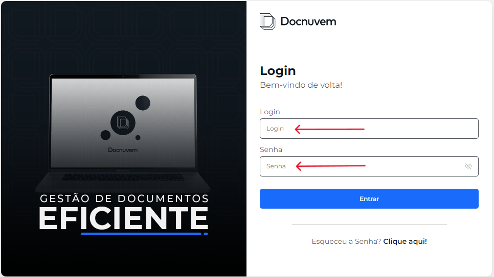
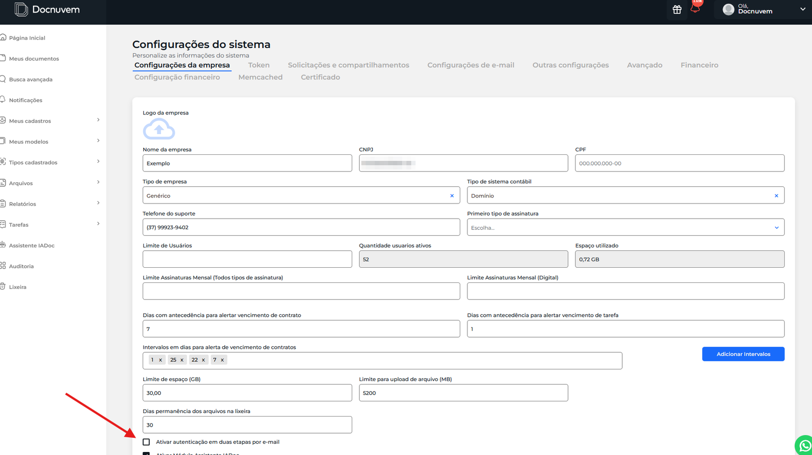
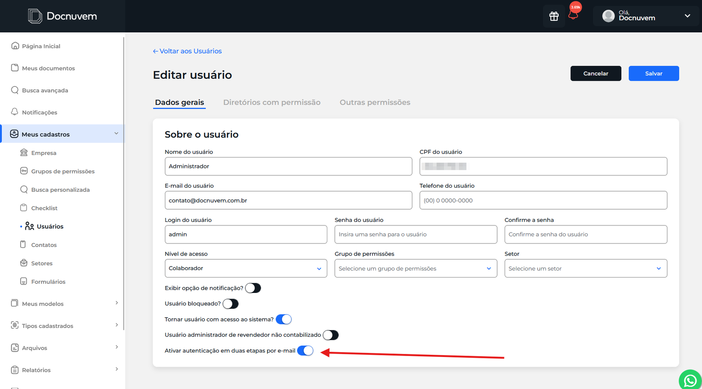
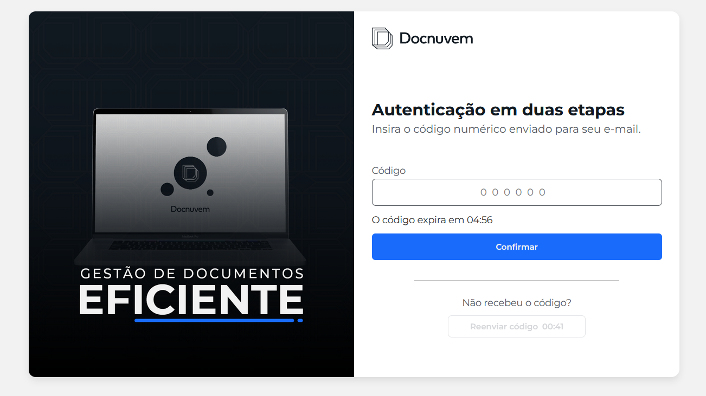
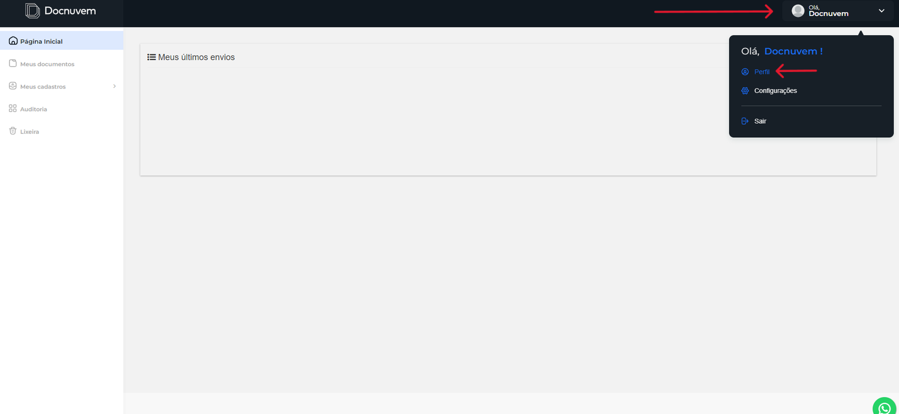
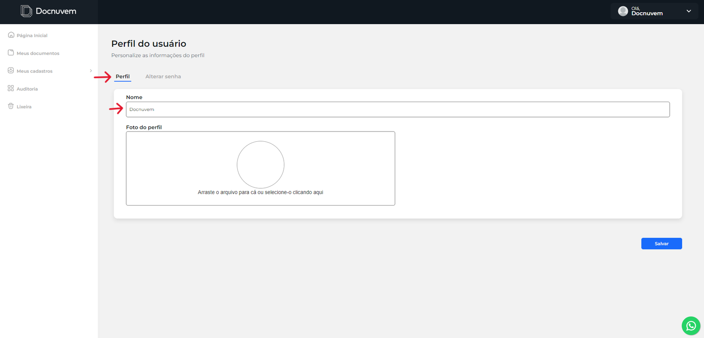
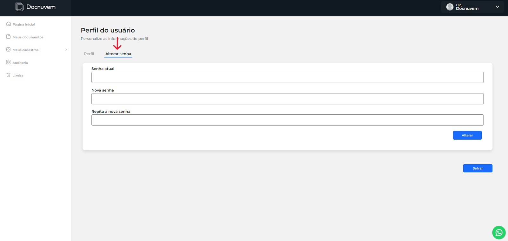
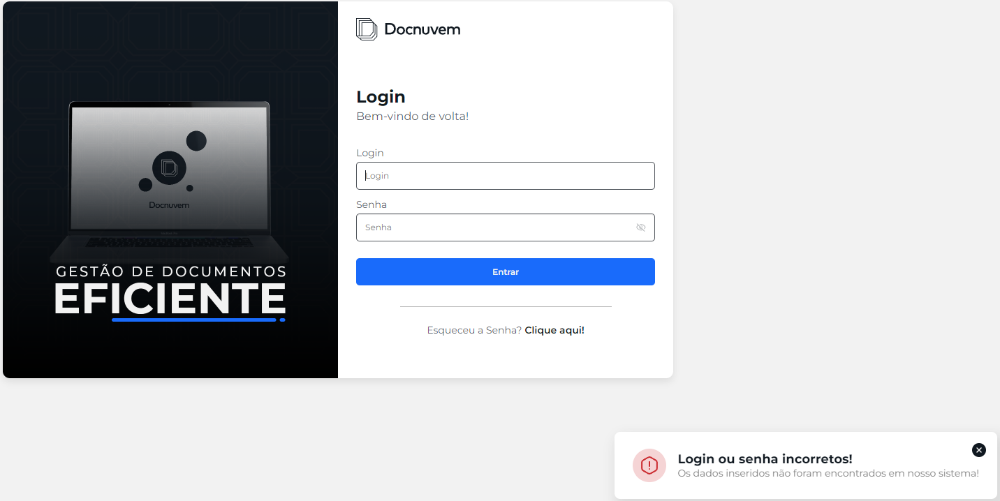
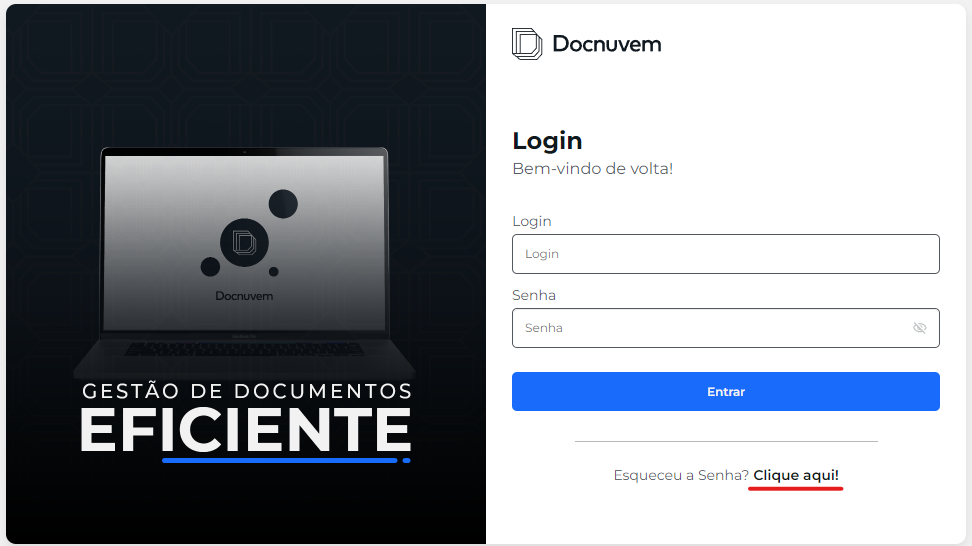
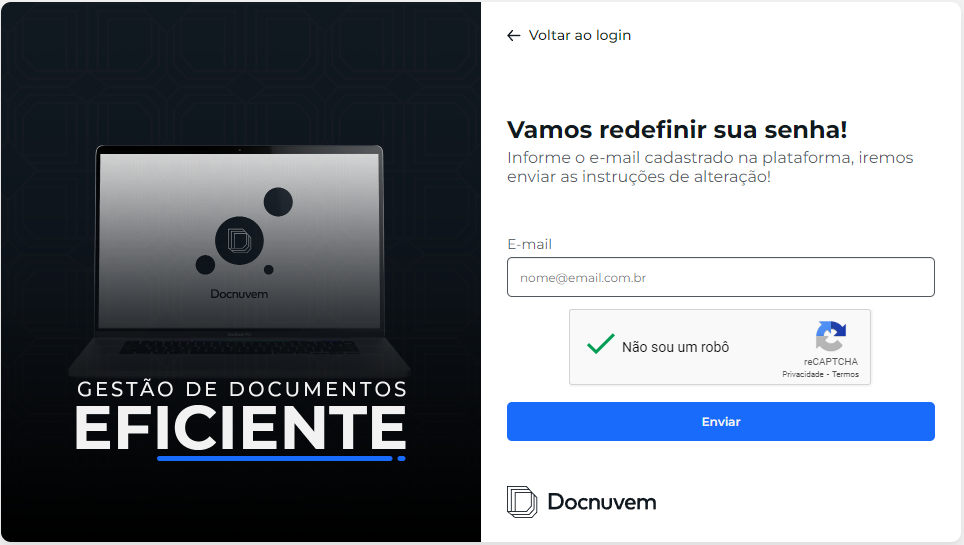

# Acessando o Sistema

Esta seção explica como entrar no Docnuvem, gerenciar suas credenciais e resolver problemas comuns de login.

## Obtendo suas credenciais de login

O nome de usuário e a senha de acesso ao Docnuvem são fornecidos pelo administrador do sistema.

Caso ainda não tenha recebido essas informações, entre em contato com o suporte do sistema ou com o administrador responsável.

## Fazendo login no sistema

Para acessar o Docnuvem, siga os passos abaixo.

### 1. Acessar a página de login

Abra o navegador e acesse a página de login do sistema.

### 2. Informar usuário e senha

Digite o **nome de usuário** e a **senha** nos campos correspondentes.

!!! tip "Print sugerido"
    `images/acessando-o-sistema/fazendo-login-no-sistema/02-usuario-e-senha.png` — mostrar os campos de usuário e senha preenchidos com dados fictícios.

### 3. Entrar no sistema

Após inserir as credenciais, clique em **Entrar** ou pressione a tecla **Enter** no teclado.

!!! tip "Print sugerido"
    `images/acessando-o-sistema/fazendo-login-no-sistema/03-botao-entrar.png` — mostrar a tela de login com uma seta vermelha apontando para o botão **Entrar**.

Se as informações estiverem corretas, o usuário é redirecionado para a página principal do sistema.

## Autenticação por e-mail

A autenticação por e-mail adiciona uma camada extra de segurança ao login. Quando essa opção está ativa, o usuário precisa informar um código de verificação enviado para sua caixa de entrada.

### Ativação global

Para utilizar essa funcionalidade, um usuário com perfil administrador deve acessar as configurações do sistema e habilitar a autenticação em duas etapas.

### Configuração por usuário

Depois da ativação global, acesse o menu **Usuários**, selecione o usuário desejado e clique em **Editar**. Em seguida, ative a opção específica para exigir a verificação por e-mail nesse perfil.

### Processo de login com verificação

Com a função ativa, após informar usuário e senha, o Docnuvem direciona o usuário para uma tela de verificação. O usuário deve consultar o e-mail, copiar o código recebido e informá-lo no campo indicado para concluir o acesso.

## Alteração de credenciais

Após fazer login com sucesso, o usuário pode alterar o nome de perfil e a senha na seção de configurações da própria conta.

É recomendado alterar a senha periodicamente para manter a segurança do acesso.

## Resolução de problemas de login

Algumas situações podem impedir o acesso ao Docnuvem. Veja as mais comuns abaixo.

### Erro de login

Se o nome de usuário ou a senha forem informados incorretamente, o sistema solicita uma nova tentativa de login.

### Redefinição de senha

Caso tenha esquecido a senha, clique em **Esqueceu a senha? Clique aqui!** na página de login e siga as instruções para redefini-la pelo e-mail cadastrado.

Se o problema continuar, entre em contato com o suporte técnico para obter assistência.

## Veja também

- [Central de Ajuda: Diagnóstico e troubleshooting](../central-de-ajuda/diagnostico-troubleshooting.md) — checagens rápidas quando um menu, botão ou funcionalidade não aparece.
