# Meus Documentos

O módulo **Meus documentos** é a área principal de organização, consulta e gestão de arquivos e diretórios no Docnuvem.

## Acessando a tela de Meus documentos

No menu lateral do Docnuvem, clique em **Meus documentos**.

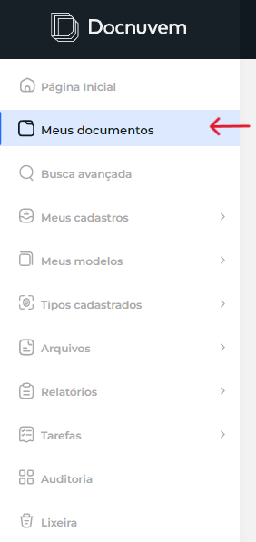

Ao abrir a tela, o sistema exibe os documentos e diretórios disponíveis para o usuário, conforme as empresas cadastradas, as permissões do perfil e a organização definida na instância.

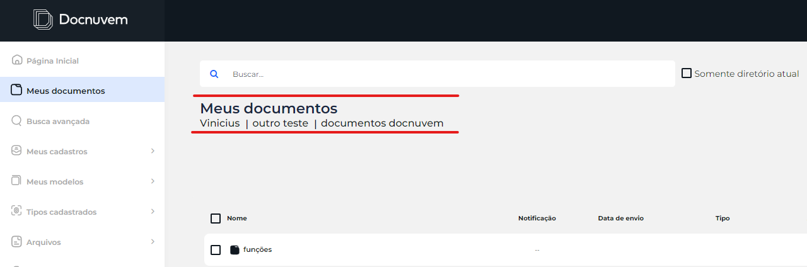

**Resultado esperado:** o usuário visualiza a estrutura de pastas e arquivos disponível no Docnuvem e pode iniciar a navegação ou o gerenciamento dos documentos.

## Navegando nos diretórios

1. Clique no nome da pasta que deseja acessar — o Docnuvem exibe o conteúdo do diretório selecionado.
2. Logo abaixo do campo **Buscar**, o sistema exibe o caminho até o diretório atual, para ajudar a entender em qual pasta você está navegando.

    

3. Para retornar à pasta raiz ou a uma pasta anterior, clique sobre o nome desejado no caminho de navegação.

**Resultado esperado:** o usuário consegue navegar entre os diretórios, localizar documentos e retornar para pastas anteriores com facilidade.

## Diretórios

Os diretórios são as pastas usadas para organizar os documentos dentro do Docnuvem. Ajudam a separar arquivos por empresa, área, processo, cliente ou qualquer outra estrutura definida pela organização. Na tela Meus documentos, o usuário pode navegar pelos diretórios, importar pastas completas e executar ações de gerenciamento, conforme as permissões do seu perfil.

### Gerenciando diretórios

As ações disponíveis podem incluir criar pasta, renomear, mover ou enviar o diretório para a lixeira, de acordo com as permissões do usuário.

1. Localize a pasta que deseja gerenciar.
2. Clique no botão **Ações** da pasta, ou clique com o botão direito do mouse sobre o nome do diretório.

    

3. Escolha a ação necessária — **Criar pasta**, **Renomear**, **Mover** ou **Mover para lixeira** — e siga as instruções exibidas pelo sistema.

**Resultado esperado:** o diretório é atualizado conforme a ação escolhida, mantendo a estrutura de pastas organizada.

### Importando diretórios

Permite enviar uma pasta completa do computador para o Docnuvem, incluindo seus arquivos e subpastas — útil quando a organização já possui uma estrutura local pronta e deseja levá-la para a plataforma.

1. Abra o local onde a pasta importada deverá ser criada.
2. Clique em **Adicionar** e selecione **Upload de pasta**.

    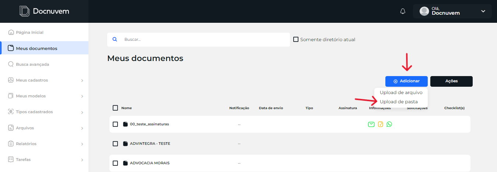

3. Selecione a pasta no computador e confirme o upload. Aguarde a conclusão do envio para garantir que os arquivos e subpastas sejam importados corretamente.

**Resultado esperado:** a pasta é importada para o Docnuvem com seus arquivos e subpastas, respeitando a estrutura selecionada no computador.

## Documentos

Os documentos representam os arquivos armazenados no Docnuvem: contratos, certificados, comprovantes, relatórios, documentos enviados por terceiros ou qualquer outro arquivo utilizado pela organização. Cada documento pode ter informações próprias, como datas, responsável, tipo de documento, histórico de ações e dados vinculados por formulário.

### Gerenciando documentos

1. Navegue pela estrutura de pastas até encontrar o arquivo que deseja gerenciar.
2. Clique no botão **Ações** do documento, ou clique com o botão direito do mouse sobre o nome do arquivo.

    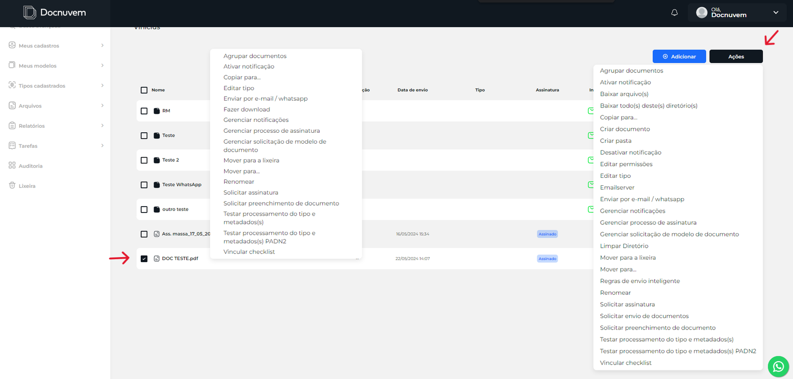

3. Selecione a ação desejada — **Mover**, **Renomear** ou **Mover para lixeira** — e siga as orientações exibidas pelo sistema.

**Resultado esperado:** o Docnuvem executa a ação selecionada e atualiza a tela conforme a alteração realizada no documento.

### Como renomear documentos e diretórios

1. Clique com o botão direito do mouse sobre o arquivo ou a pasta e selecione **Renomear**.
2. Digite o novo nome no campo exibido pelo Docnuvem.
3. Confirme a operação para salvar o novo nome.

**Resultado esperado:** o arquivo ou a pasta passa a ser exibido com o novo nome na pasta atual.

### Importando documentos

1. Abra a pasta onde o arquivo deverá ser armazenado.
2. Clique em **Adicionar** e selecione **Upload de arquivo**.

    

3. Escolha o arquivo no computador e confirme o envio. Aguarde o carregamento ser concluído antes de sair da tela.

**Resultado esperado:** o arquivo é importado para a pasta selecionada e passa a aparecer na listagem de documentos.

### Como criar documentos

Gera um novo arquivo diretamente no Docnuvem a partir de um modelo de documento já cadastrado — útil para documentos padronizados, como contratos, declarações ou termos.

!!! info "Pré-requisito"
    O [modelo de documento](08-meus-modelos.md#modelo-de-documento) correspondente já precisa estar cadastrado no sistema.

1. Abra a pasta onde o novo documento deverá ser criado.
2. Clique em **Ações** e selecione **Criar documento**.
3. Selecione o modelo de documento que será usado para gerar o arquivo.
4. Preencha o formulário com as informações solicitadas pelo modelo e informe o título do documento.
5. Confirme a criação — o Docnuvem gera o PDF do arquivo e salva o documento na pasta selecionada.

**Resultado esperado:** o documento é criado em formato PDF a partir do modelo selecionado e passa a ficar disponível na pasta escolhida.

### Como agrupar documentos

Reúne vários arquivos de uma mesma pasta em um único documento. Antes de concluir, é possível definir o nome do novo arquivo e ajustar a ordem dos documentos que o compõem.

1. Abra a pasta que contém os arquivos e marque os documentos que deseja agrupar.
2. Clique em **Ações** e selecione **Agrupar documentos**.
3. Informe o nome do arquivo agrupado. Se necessário, marque **Mover documentos para lixeira após agrupar** para enviar os arquivos originais à lixeira depois da conclusão. Na lista, ajuste a ordem dos arquivos conforme deseja que apareçam no novo documento.
4. Confirme a operação para criar o novo documento agrupado na pasta atual.

**Resultado esperado:** o Docnuvem cria um único arquivo com os documentos selecionados na ordem definida. Se a opção de mover para a lixeira estiver marcada, os arquivos originais são enviados para a lixeira.

### Visualizando documentos e seus detalhes

A visualização de um documento reúne abas com dados importantes para entender o contexto do documento, gerenciar metadados, acompanhar assinaturas, trocar comentários, controlar versões e auditar o histórico de ações.

Clique com o botão esquerdo do mouse sobre o nome do documento para abri-lo. A tela apresenta a visualização do arquivo junto ao painel de detalhes, com seis abas:

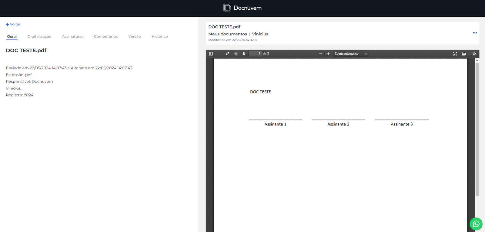

- **Geral:** informações fundamentais de identificação e localização do arquivo — **Nome e Extensão**, **Datas de Envio e Alteração**, **Responsável** (usuário que enviou o arquivo), **Diretório** (pasta onde o documento está armazenado) e **Registro** (ID único do documento no Docnuvem).
- **Digitalização:** metadados associados à captura e indexação do documento — **Título**, **Autor**, **Assunto**, **Digitalizado em**, **Local** e **Digitalizado por**.

    !!! info "Importante"
        Ao preencher ou alterar o valor de qualquer campo nesta aba, pressione **ENTER** ou **TAB** para salvar a alteração.

- **Assinaturas:** dados dos assinantes vinculados ao arquivo e gerenciamento das solicitações de assinatura — visualizar os dados dos assinantes e o status de cada solicitação, reenviar notificações de cobrança e cancelar o fluxo pelo menu de ações (veja [Como cancelar um fluxo de assinatura](#como-cancelar-um-fluxo-de-assinatura)).
- **Comentários:** troca de observações e notas sobre o documento entre usuários. Para comentar, digite a mensagem no campo **Insira seu comentário...** e confirme. Os comentários são listados com autor e horário, e cada novo comentário notifica automaticamente o usuário responsável pelo documento.
- **Versão:** rastreabilidade e histórico de revisões do arquivo — todas as versões, com data, hora, usuário responsável e tipo de alteração realizada (por exemplo, inclusão de assinatura digital), além da opção de enviar uma nova versão. Arquivos com fluxo de assinatura concluído mantêm registradas tanto a versão assinada quanto a versão final.
- **Histórico:** linha do tempo e trilha de auditoria de todas as interações com o documento — consultas e visualizações, solicitações e configurações de posição de assinaturas, conclusão do fluxo de assinaturas, e vinculação ou alteração do tipo de documento e do diretório.

**Resultado esperado:** o usuário consegue consultar detalhadamente todas as abas do documento, editar metadados, acompanhar versões, verificar assinaturas, adicionar comentários e auditar o histórico completo do arquivo.

### Vinculando e editando informações de formulário no documento

Um formulário pode ser vinculado a um documento para registrar informações adicionais sobre o arquivo, mantendo dados estruturados junto ao documento e facilitando consultas e atualizações futuras.

!!! info "Pré-requisito"
    O formulário precisa estar cadastrado no sistema (veja [Cadastro de Formulários](07-meus-cadastros.md#formularios)).

1. Clique com o botão direito sobre o arquivo e selecione **Vincular formulário**. Em seguida, escolha o formulário a relacionar ao documento.
2. Após a vinculação, o Docnuvem exibe um ícone no arquivo, indicando que o documento possui informações de formulário associadas.

    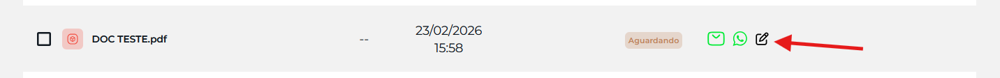

3. Para editar as informações, clique no ícone exibido no documento — o sistema abre a tela de edição com os campos do formulário vinculado. Também é possível editar pela aba **Formulário**, dentro da tela do arquivo.

    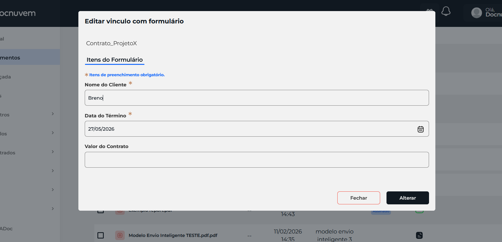

    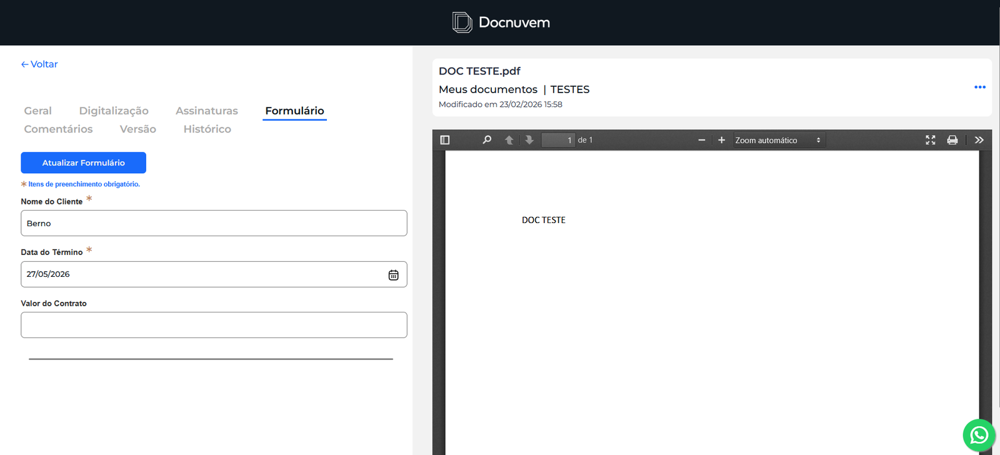

**Resultado esperado:** o documento passa a exibir o indicador de formulário vinculado, e suas informações podem ser atualizadas tanto pelo ícone da listagem quanto pela aba Formulário.

## Assinaturas

### Como solicitar uma assinatura em um arquivo

O Docnuvem permite solicitar assinaturas digitais em arquivos PDF. A plataforma possui os assinadores **V1** e **V2**; a versão disponível depende da configuração utilizada pela empresa.

!!! info "Pré-requisito"
    O arquivo a enviar para assinatura deve estar no formato PDF.

No **assinador V1**, o carimbo de assinatura apresenta somente o nome do assinante. É possível adicionar mais de um carimbo no mesmo documento e incluir rubricas no rodapé das páginas. Permite assinatura com certificado A1, certificado em nuvem, Syn e BirdID, além de assinatura em massa para usuários do sistema (para saber mais sobre esse recurso, contate o suporte).

No **assinador V2**, o carimbo apresenta mais informações do assinante — CPF/CNPJ, data e hora da assinatura e e-mail — mas cada arquivo permite somente um carimbo de assinatura. Oferece validação por token OTP, mais opções de certificados em nuvem e um relatório de assinaturas mais completo (o relatório do V1 continua contendo todas as informações necessárias para validar a assinatura).

O fluxo de solicitação é o mesmo nas duas versões:

1. Localize o arquivo PDF que deverá ser assinado.
2. Clique com o botão direito no arquivo e selecione **Solicitar assinatura**.

    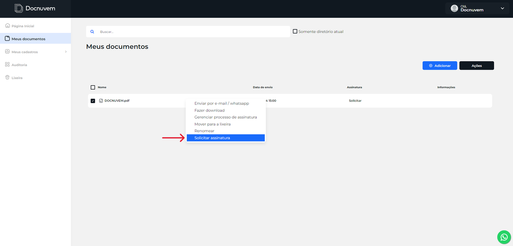

3. Adicione os assinantes pela opção **Contatos** ou pela opção **Cadastrar** — ao cadastrar, informe **Nome**, **CPF/CNPJ**, **E-mail** e **Telefone** (**Nome** e **E-mail** são obrigatórios). É possível ativar a selfie do assinante (as selfies ficam disponíveis nos relatórios); no V2, também é possível ativar o token OTP, enviado por e-mail, WhatsApp ou SMS.

    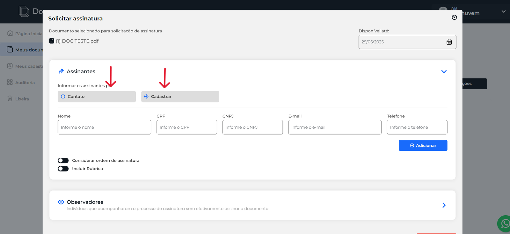

4. Se necessário, ative **Considerar a ordem de assinatura** para que os links sejam enviados aos assinantes conforme a ordem definida.

    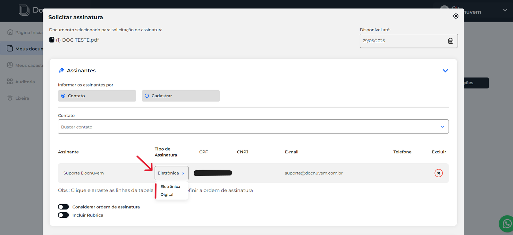

5. Adicione os observadores que acompanharão o processo sem assinar o arquivo — eles recebem notificações a cada atualização da solicitação. Se necessário, altere a mensagem enviada aos participantes.

    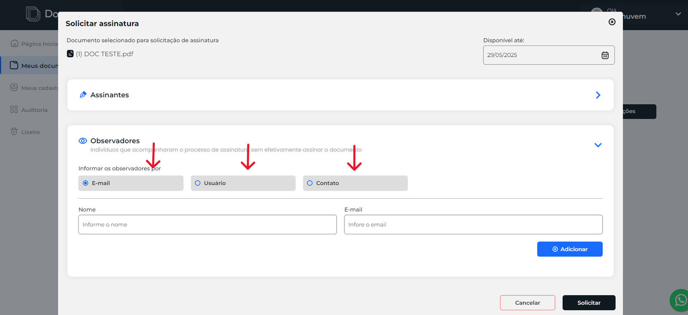

<!-- TODO: a nota-fonte referenciava "Solicitações e Compartilhamentos", ainda sem conteúdo no vault (pasta TODO). Detalhar aqui como alterar permissões e informações de envio quando essa nota existir — confirmar com Breno. -->

### Como cancelar um fluxo de assinatura

Interrompe a coleta de assinaturas em um documento, invalidando as solicitações pendentes e impedindo novas assinaturas no arquivo.

!!! info "Pré-requisito"
    Você precisa ter permissão de gerenciamento sobre o documento ou sobre o fluxo de assinatura iniciado.

1. Abra o documento com o fluxo de assinatura em andamento e acesse a aba **Assinaturas**.
2. Clique no botão de **Ações** referente ao fluxo de assinatura ativo.
3. No menu suspenso, clique em **Cancelar fluxo de assinaturas**.
4. Na caixa de diálogo exibida, confirme a intenção de cancelar o fluxo.

**Resultado esperado:** o fluxo de assinaturas é cancelado, o status da solicitação é atualizado e todas as notificações de cobrança pendentes são interrompidas.

## Solicitações de documentos

### Como solicitar o preenchimento de documentos

Envia uma solicitação para que outra pessoa preencha o formulário definido no modelo. Após o preenchimento, o Docnuvem cria o documento na pasta selecionada.

!!! info "Pré-requisito"
    O [modelo de documento](08-meus-modelos.md#modelo-de-documento) que será utilizado deve estar cadastrado no sistema.

1. Localize a pasta onde o documento deverá ser armazenado após o preenchimento.
2. Clique com o botão direito na pasta e selecione **Solicitar preenchimento de documento** (ou selecione a pasta, clique em **Ações** e escolha essa opção).

    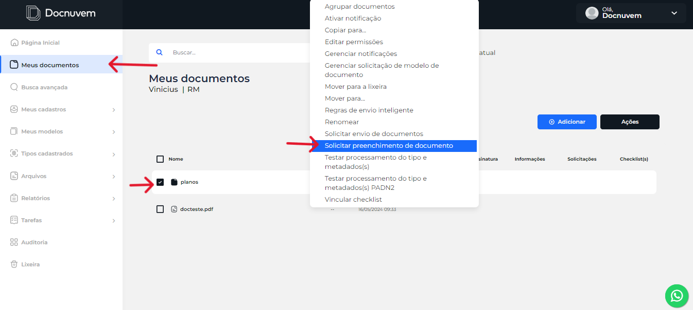

3. Na janela de configurações, selecione o modelo de documento e informe o nome do documento que será criado. Se necessário, defina a data de vencimento da solicitação e o contato do destinatário.

    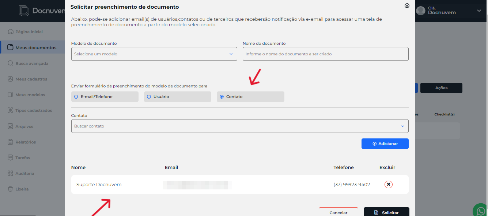

4. Clique em **Solicitar**. O destinatário recebe a solicitação por e-mail ou WhatsApp e, ao acessá-la, pode preencher o formulário.

### Como solicitar o envio de documentos

Permite pedir arquivos a um usuário ou contato e definir a pasta em que eles deverão ser armazenados.

!!! info "Pré-requisito"
    É necessário ter um [modelo de solicitação](08-meus-modelos.md#modelo-de-solicitacao) cadastrado.

1. Localize a pasta onde os documentos solicitados deverão ser salvos.
2. Clique com o botão direito na pasta e selecione **Solicitar envio de documentos**.

    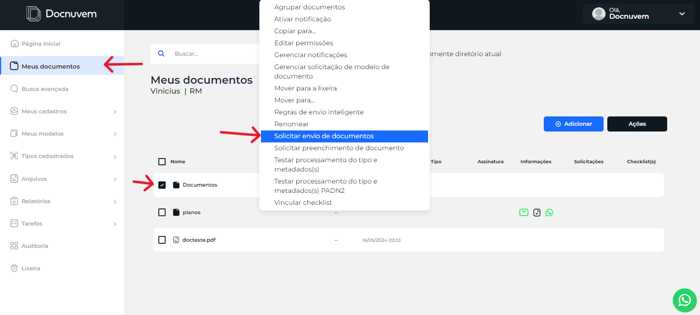

3. Selecione o modelo de solicitação e informe o nome do documento que será criado. Se necessário, defina a data de vencimento da solicitação.
4. Preencha os complementos do documento, se necessário (esses campos também podem ser configurados diretamente no modelo de solicitação).
5. No campo **Enviar formulário de preenchimento do modelo de documento para**, escolha o tipo de destinatário: **E-mail/Telefone**, **Usuário** ou **Contato**. Ao selecionar **Contato**, informe nome, e-mail e telefone do destinatário.

    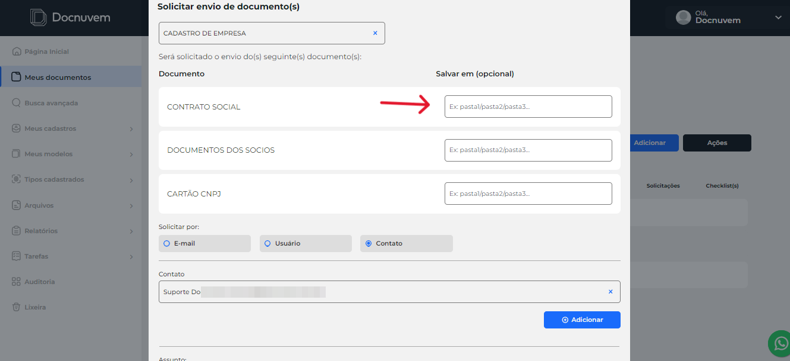

6. Clique em **Adicionar** para incluir o destinatário na solicitação.

    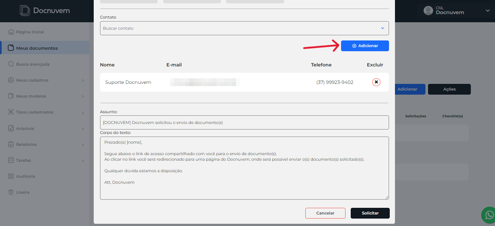

7. Clique em **Solicitar** para disparar a solicitação.

Para acompanhar o andamento dos envios, veja [Significado dos ícones](#significado-dos-icones).

<!-- TODO: a nota-fonte referencia "Solicitações e Compartilhamentos", ainda sem conteúdo no vault (pasta TODO). Detalhar aqui como alterar permissões e informações de envio quando essa nota existir — confirmar com Breno. -->

### Como acompanhar e enviar pendências no envio de documentos

Depois que uma solicitação de envio de documentos é criada, o Docnuvem permite acompanhar os arquivos recebidos e devolver como pendência os itens enviados incorretamente.

1. Acesse a pasta onde está a solicitação de documentos.

    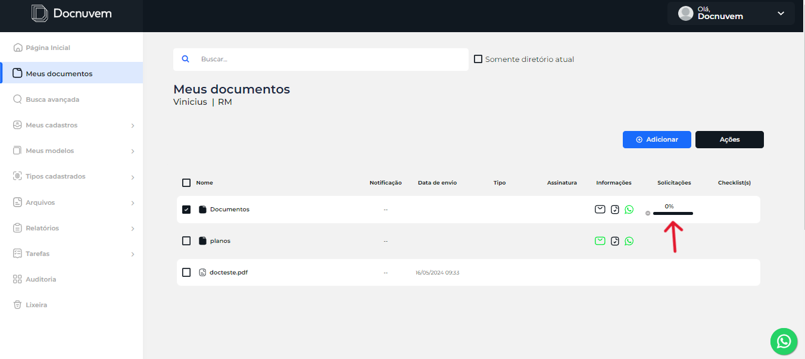

2. Clique no ícone da solicitação para acessar os documentos enviados pelo destinatário.

    

3. Selecione a solicitação que deseja revisar e clique para expandi-la — os status dos itens enviados ficam visíveis para conferência.
4. Selecione os documentos enviados incorretamente, marque **Enviar pendência** e escreva uma breve observação informando o motivo da recusa ao destinatário.

    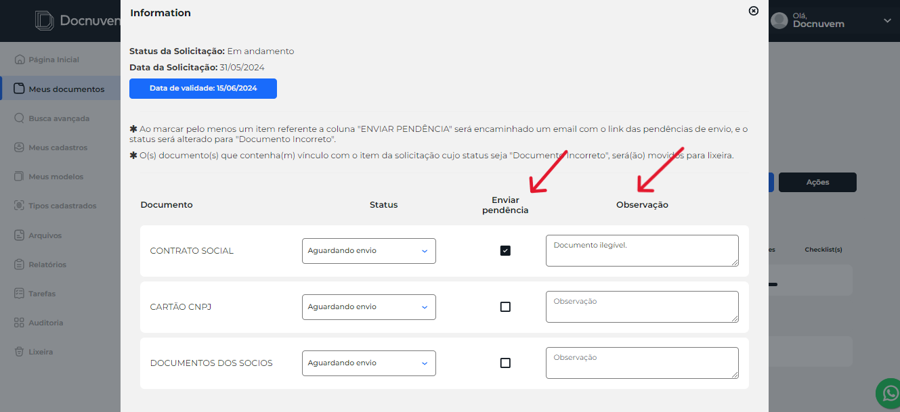

5. Clique em **Salvar**. As notificações de pendência são enviadas automaticamente ao destinatário.

!!! info "Importante"
    Os documentos rejeitados são enviados automaticamente para a lixeira.

#### Alterar a data de validade

Para prorrogar o prazo de envio dos documentos, abra a solicitação e clique no botão **Data de validade**. Na janela **Prorrogação do prazo de envio**, selecione a nova data no calendário e clique em **Ok**.

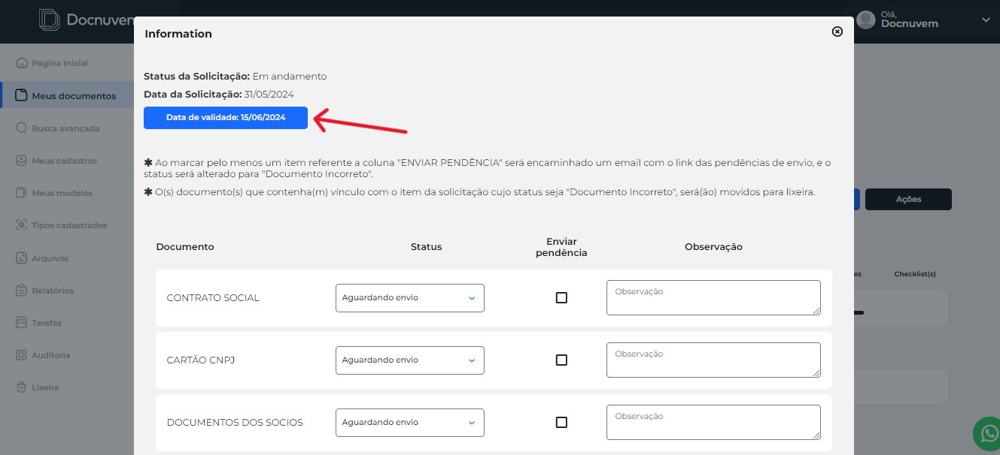

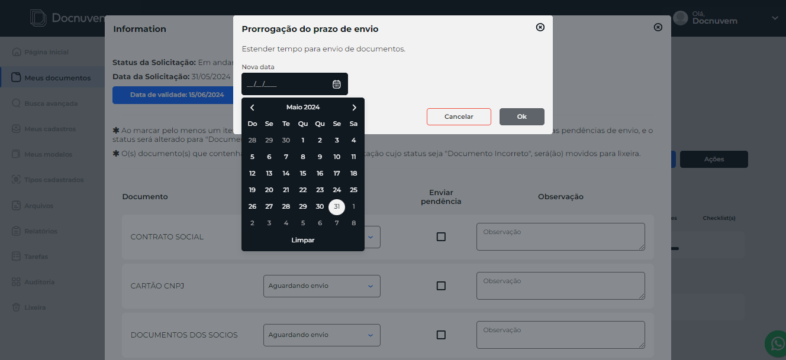

### Como excluir uma solicitação de documentos

1. Acesse a pasta onde está a solicitação de documentos.
2. Clique no ícone da solicitação para acessar as solicitações vinculadas à pasta.

    

3. Selecione a solicitação que deseja excluir e clique para expandi-la.
4. Na solicitação expandida, clique em **Desvincular** para excluí-la.

### Como enviar uma solicitação pelo WhatsApp

Depois de criar uma solicitação de preenchimento, de envio de documentos ou de assinatura, é possível enviar o link ao destinatário pelo WhatsApp. Há duas formas: usando um número já cadastrado na plataforma ou pela API aberta, que dispara o WhatsApp logado na máquina em que a solicitação está sendo feita.

1. Crie a solicitação normalmente, conforme o guia do tipo escolhido. Ao final, o ícone do WhatsApp passa a aparecer na coluna **Informações** da listagem.

    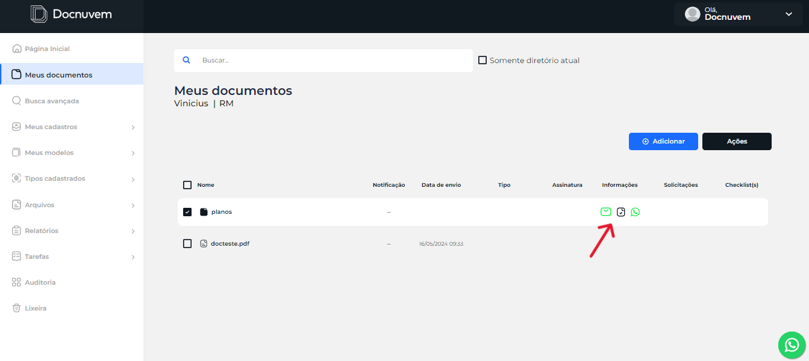

2. Clique no ícone do WhatsApp. O Docnuvem abre uma janela com as solicitações da pasta. Nas solicitações de assinatura com mais de um participante, a janela lista os participantes; com um só participante, o WhatsApp Web já é aberto para iniciar a conversa.

    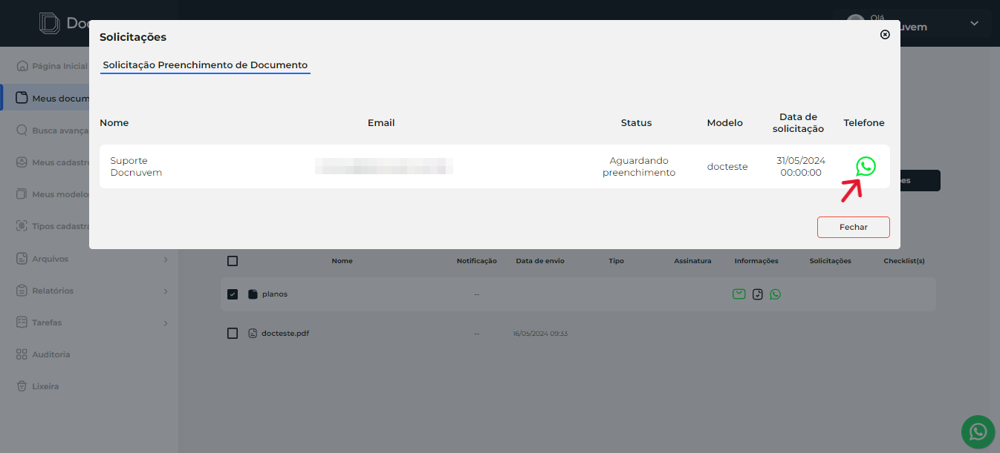

3. Se houver um número conectado como responsável pelos envios, o Docnuvem apenas informa que a solicitação foi enviada com sucesso. Caso contrário, o WhatsApp Web é aberto com a mensagem pronta: clique em **Iniciar conversa**. Se o aplicativo do WhatsApp não estiver instalado na máquina, o WhatsApp oferece baixá-lo ou continuar pelo **WhatsApp Web**.

!!! info "Importante"
    - O ícone do WhatsApp só aparece se o número de telefone do destinatário tiver sido informado. Mantenha os telefones dos contatos atualizados.
    - O Docnuvem usa o perfil do WhatsApp que estiver logado na máquina no momento do envio. Confirme que é o perfil que realmente deve enviar a solicitação.

As solicitações agendadas também podem ser integradas ao WhatsApp. Quando a automação está configurada, o link de envio é disparado para o WhatsApp do contato responsável sempre que um novo ciclo de recorrência começa, sem acionamento manual. É indicado para rotinas recorrentes de cobrança de documentos.

<!-- TODO: confirmar com Breno como ativar essa automação e como conectar um número para os envios (a nota "Como conectar o Whatsapp" ainda está vazia no vault — pasta TODO). -->

## Agendamento de solicitações

### Como agendar solicitações de documentos

Programa o envio recorrente de pedidos de documentos. O preenchimento dos dados da solicitação segue o mesmo processo de [Como solicitar o envio de documentos](#como-solicitar-o-envio-de-documentos).

!!! info "Pré-requisito"
    É necessário ter um [modelo de solicitação](08-meus-modelos.md#modelo-de-solicitacao) cadastrado.

1. Localize a pasta onde os documentos enviados deverão ser salvos.
2. Clique com o botão direito na pasta e selecione **Agendar solicitação (envio de documentos)**.

    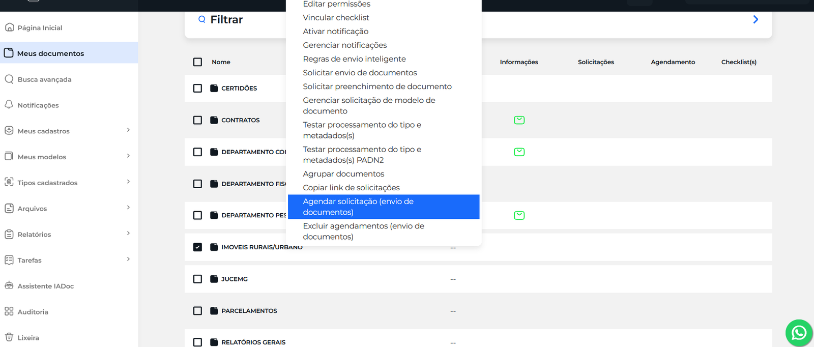

3. Selecione o modelo de solicitação, informe o nome do documento e, se necessário, defina a data de vencimento.

    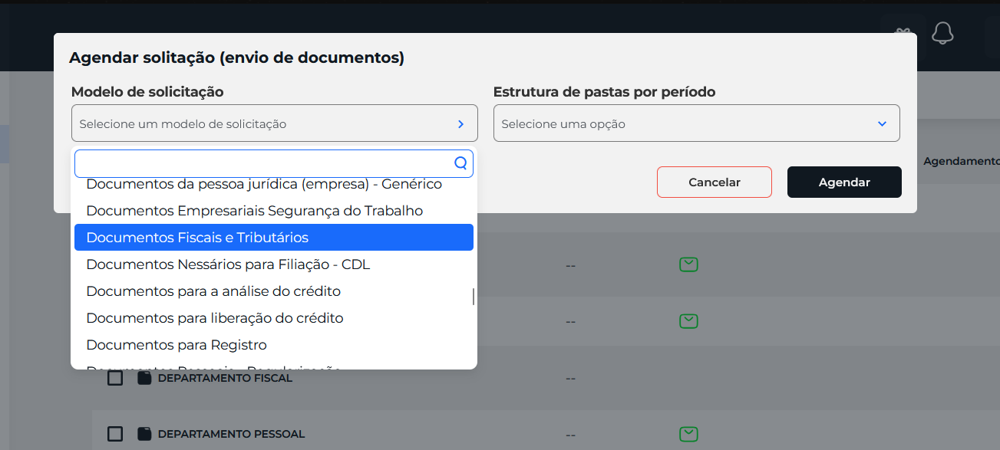

4. Preencha os complementos do documento, se necessário.
5. Se necessário, ative a criação automática de diretórios para que os documentos sejam salvos conforme o período em que forem enviados: **Anual**, **Anual/Mensal**, **Anual/Trimestral** ou **Anual/Trimestral/Mensal**.
6. Informe o destinatário da solicitação e clique em **Adicionar**.

    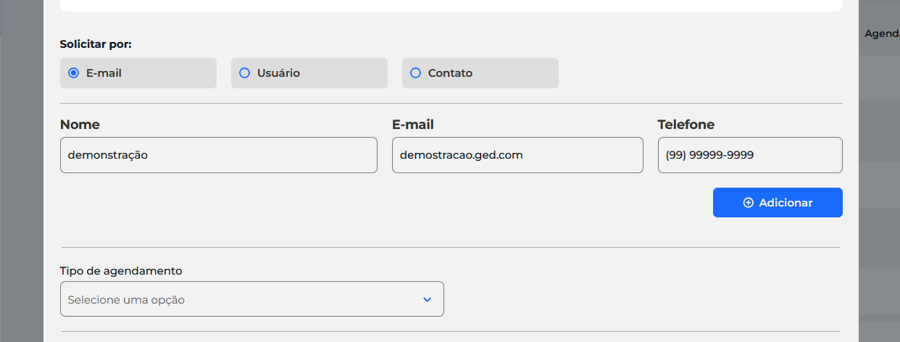

7. Configure a frequência da solicitação:
    - **Diário:** informe a hora de envio.
    - **Semanal:** informe a hora e selecione os dias da semana.
    - **Quinzenal:** informe a hora — a solicitação é enviada quinzenalmente a partir da data de criação do agendamento.
    - **Mensal:** informe a hora e o tipo de execução mensal — **Dia fixo do mês** (informe o dia), **Primeira/Última Ocorrência do Mês** (dia da semana e ocorrência) ou **Último dia do mês** (envio automático no último dia do mês vigente).
    - **Anual:** informe a hora, o mês e o dia.

    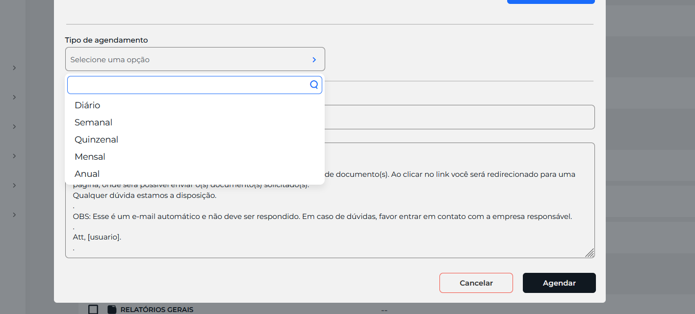

8. Revise as informações da solicitação e confirme o agendamento.

**Resultado esperado:** o Docnuvem envia as solicitações de documentos conforme a frequência definida.

### Como editar um agendamento de solicitação de documentos

1. Acesse a pasta onde está o agendamento que deseja alterar.
2. Clique no ícone de agendamentos para visualizar os agendamentos vinculados à pasta.

    

3. Localize o agendamento e clique no ícone de edição.
4. Atualize as informações necessárias e clique em **Salvar**.

### Como cancelar um agendamento de solicitação de documentos

1. Acesse a pasta onde está o agendamento que deseja cancelar.
2. Clique no ícone de agendamentos para visualizar os agendamentos vinculados à pasta.

    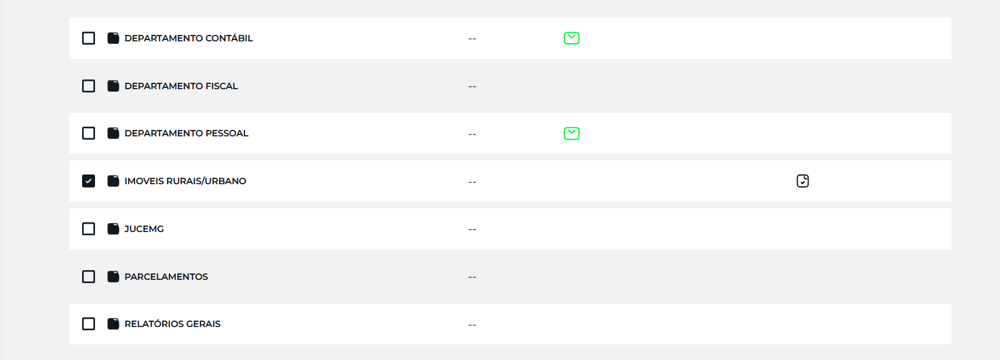

3. Localize o agendamento e clique no ícone de lixeira.

## Significado dos ícones

Na listagem da tela **Meus documentos**, alguns ícones mostram o andamento das solicitações de preenchimento, de envio de documentos e de assinatura.

### Ícones da coluna Informações

Depois de enviar uma solicitação, três ícones aparecem na coluna **Informações**, à frente da pasta (ou do arquivo, no caso de assinatura):

1. **Envio do e-mail:** mostra o status do envio do e-mail ao destinatário.
2. **Visualização do link:** mostra o status de visualização do link do e-mail pelo destinatário.
3. **WhatsApp:** permite enviar a solicitação pelo WhatsApp (veja [Como enviar uma solicitação pelo WhatsApp](#como-enviar-uma-solicitacao-pelo-whatsapp)).

### Cores dos ícones

- **Preto:** ainda não foi enviado ou visualizado.
- **Laranja/amarelo:** apenas parte dos envios ou das visualizações foi concluída (um de vários destinatários).
- **Vermelho:** houve erro no envio ou na visualização.
- **Verde:** enviado ou visualizado.

### Progresso da solicitação

Nas solicitações de envio de documentos, a coluna **Solicitações** exibe uma barra de progresso, que mostra quantos dos documentos solicitados já foram recebidos.

### Solicitações de assinatura

Para arquivos com solicitação de assinatura, a coluna **Assinatura** mostra o status geral do fluxo: **Em andamento**, **Cancelado** ou **Assinado**. A coluna **Informações** traz três ícones que abrem os detalhes do envio.

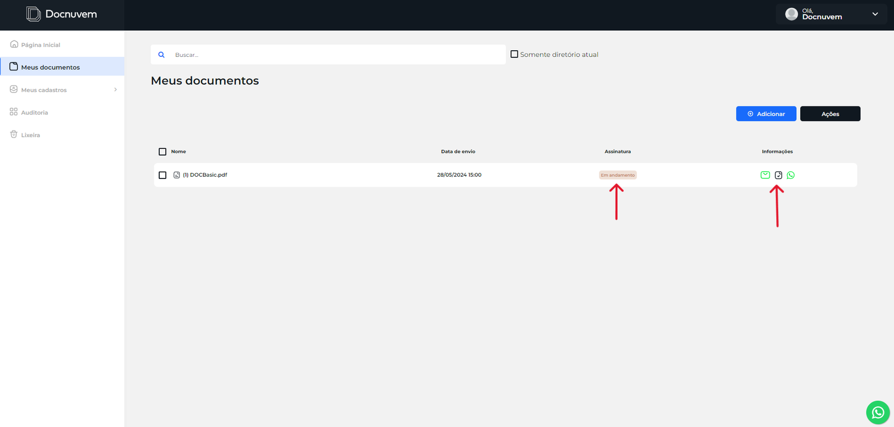

- **E-mail(s) enviado(s):** lista o nome de todos os participantes do fluxo e registra a data e a hora em que o e-mail foi enviado a cada um.

    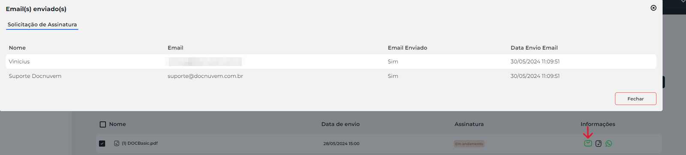

- **Link(s) visualizado(s):** lista os participantes e registra a data e a hora em que cada um abriu e visualizou o documento.

    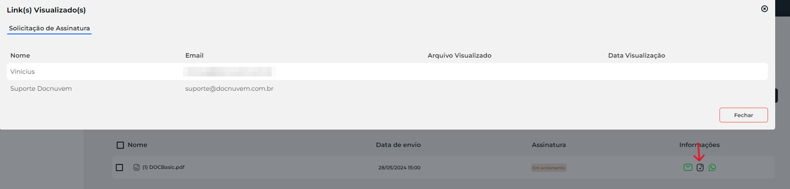

- **Envio WhatsApp:** lista os participantes e permite enviar a cada um o link de acesso e assinatura do documento pelo WhatsApp.

    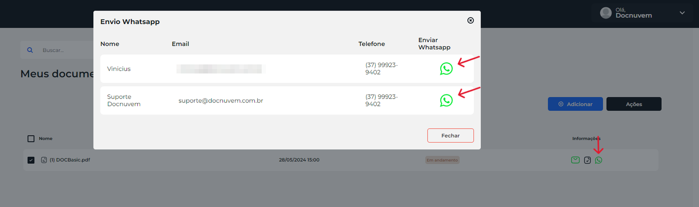

!!! info "Importante"
    O ícone do WhatsApp só aparece na coluna **Informações** se o número de telefone do participante tiver sido informado. Mantenha os telefones dos contatos atualizados e confira os dados ao criar a solicitação.

## Veja também

- [Meus Modelos](08-meus-modelos.md) — modelos de documento, diretório e solicitação usados nos fluxos deste módulo.
- [Meus Cadastros](07-meus-cadastros.md) — cadastro de formulários e contatos usados em solicitações.
- [Lixeira](13-lixeira.md) — recuperar documentos ou diretórios excluídos.
