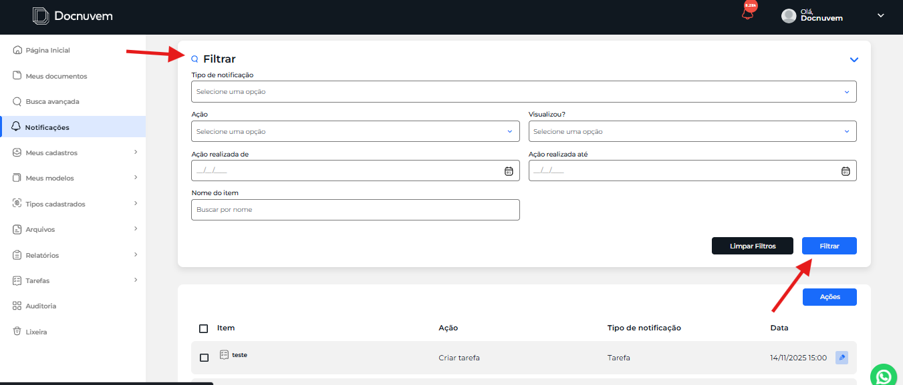
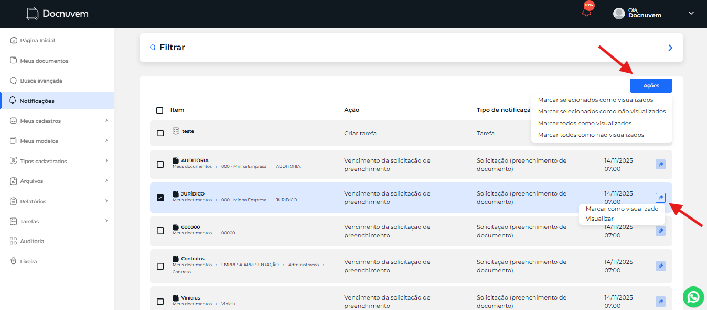

# Notificações

A central de **Notificações** exibe os alertas e avisos do sistema sobre solicitações, assinaturas, comentários e pendências atribuídas ao usuário.

Nela, o usuário acompanha os processos de que participa: comentários em documentos, coletas de assinaturas, alertas de vencimento de tarefas e de contratos, entre outras notificações emitidas pelo Docnuvem.

Para abrir a tela, clique em **Notificações** no menu lateral.

## Como filtrar notificações

Use os filtros para encontrar notificações específicas.

1. Na tela de **Notificações**, clique em **Filtrar** para exibir os campos de busca.

    

2. Preencha os campos que desejar. Todos são opcionais e podem ser combinados:
    - **Tipo de notificação:** tipo do processo que gerou a notificação, como tarefa ou solicitação de preenchimento de documento.
    - **Ação:** ação que gerou a notificação, como **Criar tarefa** ou **Vencimento da solicitação de preenchimento**.
    - **Visualizou?:** indica se a notificação já foi visualizada.
    - **Ação realizada de** e **Ação realizada até:** período em que a ação aconteceu.
    - **Nome do item:** nome do item relacionado à notificação.
3. Clique em **Filtrar**. Para remover os filtros e voltar à lista completa, clique em **Limpar Filtros**.

**Resultado esperado:** a lista exibe somente as notificações que atendem aos filtros informados.

## Como marcar notificações como visualizadas

Marque as notificações como visualizadas ou não visualizadas para controlar o que ainda precisa de atenção.

**Para marcar uma notificação**, clique no ícone de lápis no final da linha e escolha uma das opções:

- **Marcar como visualizado**
- **Visualizar**

**Para marcar várias notificações**, marque a caixa de seleção das notificações desejadas e clique em **Ações**. Escolha uma das opções:

- **Marcar selecionados como visualizados**
- **Marcar selecionados como não visualizados**

Para aplicar a marcação a todas as notificações, sem selecionar uma a uma, escolha **Marcar todos como visualizados** ou **Marcar todos como não visualizados**.

<!-- TODO: confirmar com Breno o que a opção Visualizar faz (abrir o item de origem da notificação?). O manual antigo também diz que essas opções servem para "continuar ou parar de receber alertas de uma certa ação" — confirmar se isso procede. -->

**Resultado esperado:** as notificações passam a constar como visualizadas ou não visualizadas, conforme a opção escolhida.

## Veja também

- [Central de Ajuda: Visão geral do sistema](../central-de-ajuda/visao-geral.md)
