# Meus Cadastros

O módulo **Meus cadastros** reúne os registros que dão suporte às operações do Docnuvem: usuários, grupos de permissões, setores, contatos, empresas/ARs/agências, formulários, checklists e buscas personalizadas.

## Usuários

O cadastro de **Usuários** controla quem pode acessar o Docnuvem e quais áreas, diretórios e funcionalidades cada pessoa pode utilizar.

### Como cadastrar um Usuário

1. No menu principal, acesse **Meus cadastros** e clique em **Usuários**.

    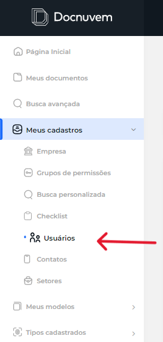

2. Na tela de listagem, clique em **Cadastrar novo usuário**.

    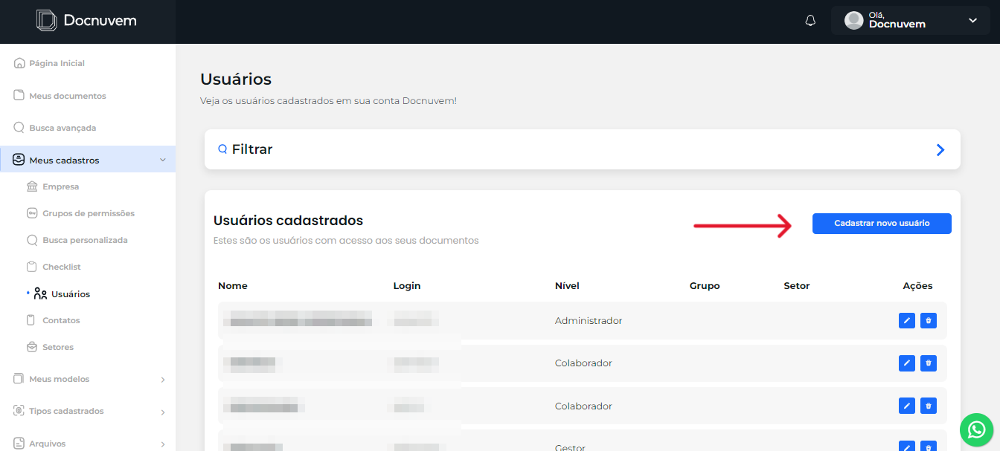

3. Preencha os campos obrigatórios de identificação: **Nome**, **CPF** e **E-mail**.

    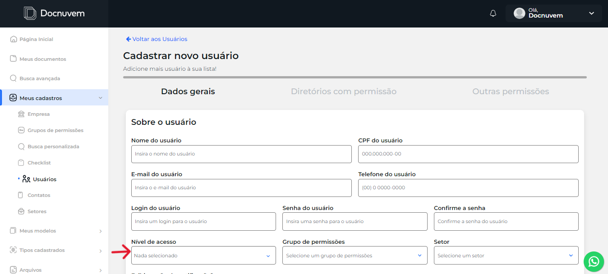

4. Selecione o **Nível de acesso** adequado para limitar o usuário às áreas autorizadas.
5. Na aba **Diretórios com permissão**, selecione as pastas e subpastas que o usuário poderá acessar, e defina se ele poderá visualizar, criar, editar ou excluir documentos e pastas.

    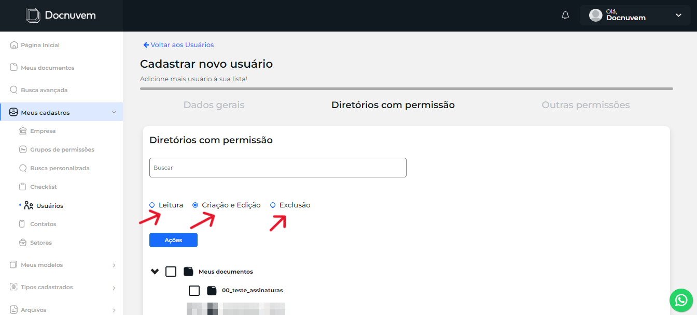

6. Na aba **Outras Permissões**, marque as permissões adicionais necessárias — elas controlam ações sobre diretórios, documentos e outras funcionalidades.

    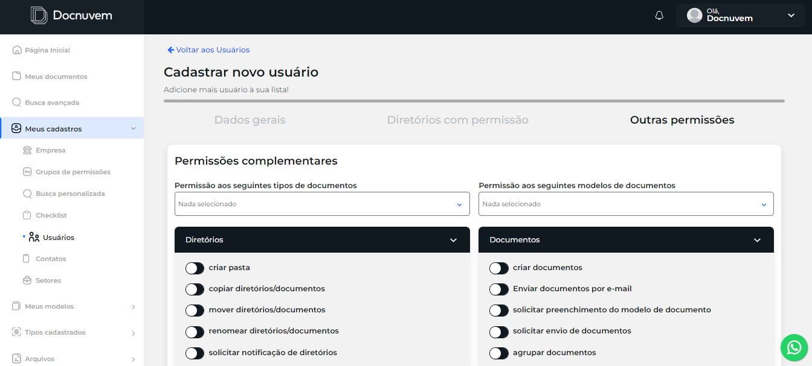

7. Revise as informações e permissões e clique em **Salvar**.

**Resultado esperado:** o usuário fica cadastrado e passa a acessar o Docnuvem conforme as permissões configuradas.

### Como editar um Usuário

1. Acesse **Meus cadastros** → **Usuários** (ou clique em **Voltar aos Usuários** se já estiver na tela de cadastro).
2. Clique no balão **Filtrar**, informe os critérios de busca e clique em **Filtrar**.

    

3. Na coluna **Ações**, clique no ícone de lápis do usuário.

    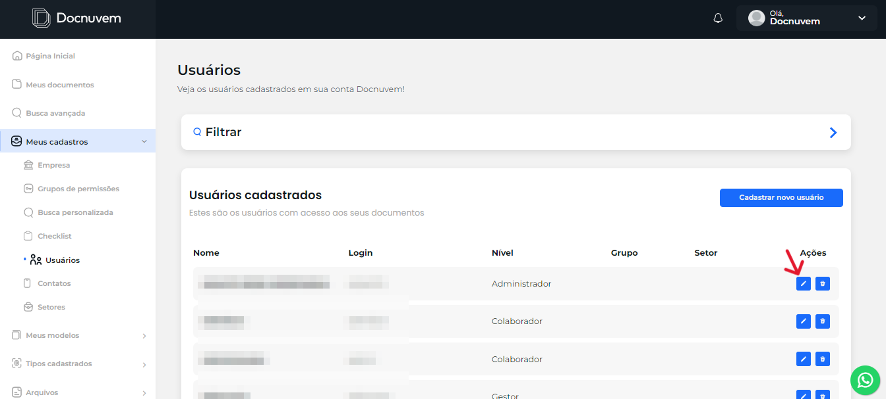

4. Atualize os dados ou permissões necessárias e clique em **Salvar**.

**Resultado esperado:** o usuário passa a utilizar as informações e permissões atualizadas.

### Como excluir um Usuário

1. Acesse a listagem de **Usuários** e use o balão **Filtrar** para encontrar o registro.

    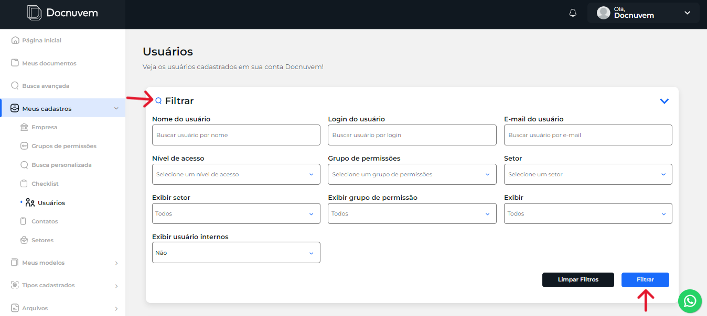

2. Na coluna **Ações**, clique no ícone de lixeira do usuário.

    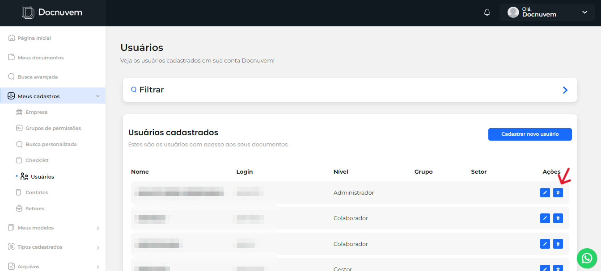

3. Na notificação exibida pelo sistema, confirme a exclusão.

**Resultado esperado:** o usuário é removido da listagem.

## Grupo de permissões

O cadastro de **Grupo de permissões** permite organizar permissões de acesso para vários usuários ao mesmo tempo — quais diretórios, documentos, checklists, assinaturas, tarefas e outras funcionalidades poderão ser acessados por usuários com o mesmo perfil de atuação.

### Como cadastrar um Grupo de permissões

1. Acesse **Meus cadastros** → **Grupo de permissões**.

    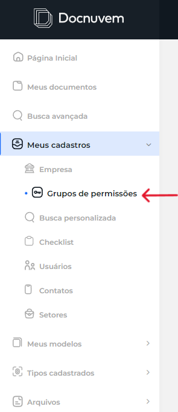

2. Na listagem, clique em **Cadastrar novo grupo**.

    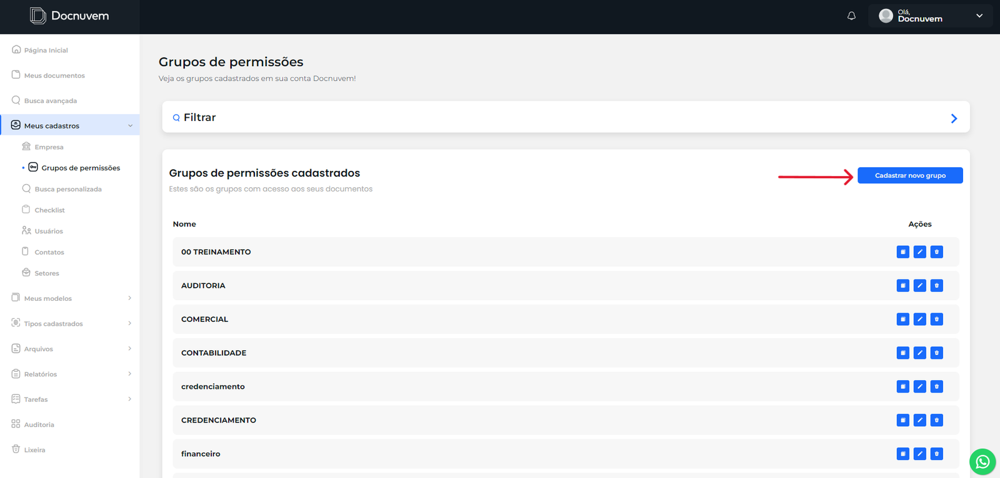

3. Na primeira aba, informe um nome que represente claramente a função ou o perfil dos usuários que farão parte do grupo.

    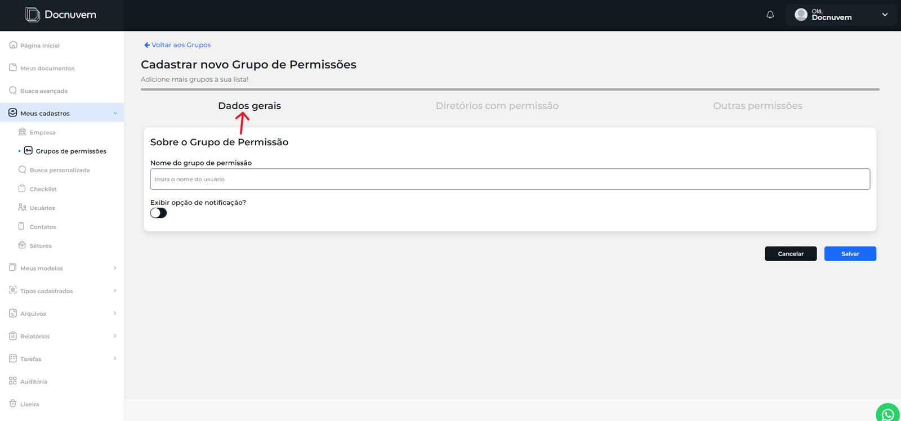

4. Na aba **Diretórios com permissão**, selecione as pastas e subpastas que os usuários do grupo poderão acessar, e defina se poderão visualizar, criar, editar ou excluir documentos e pastas.

    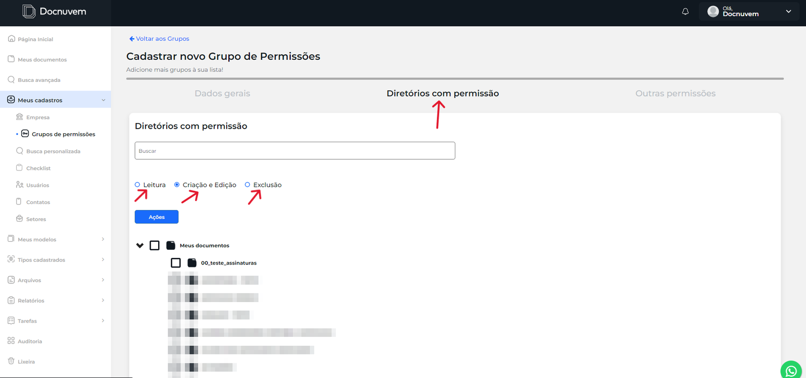

5. Na aba **Outras Permissões**, marque as permissões adicionais necessárias (diretórios, documentos, checklists, assinaturas, tarefas e outras funcionalidades).

    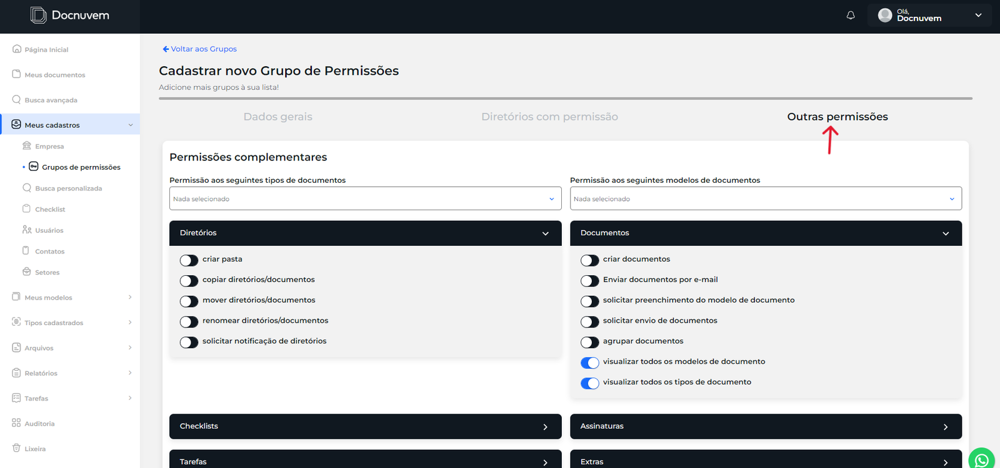

6. Revise e clique em **Salvar**.

**Resultado esperado:** o grupo fica disponível para associação aos usuários.

### Como editar um Grupo de permissões

1. Acesse **Meus cadastros** → **Grupo de permissões** (ou **Voltar aos Grupos**, se já estiver no cadastro).
2. Clique no balão **Filtrar**, informe o nome do grupo e clique em **Filtrar**.

    

3. Na coluna **Ações**, clique no ícone de lápis do grupo.

    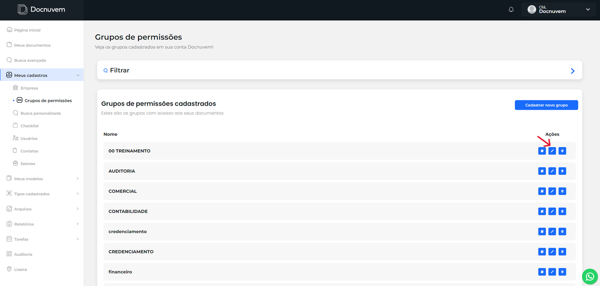

4. Atualize o nome, os diretórios ou as permissões necessárias e clique em **Salvar**.

**Resultado esperado:** as permissões do grupo são atualizadas.

### Como excluir um Grupo de permissões

1. Acesse a listagem de **Grupo de permissões** e use o balão **Filtrar** para encontrar o grupo.

    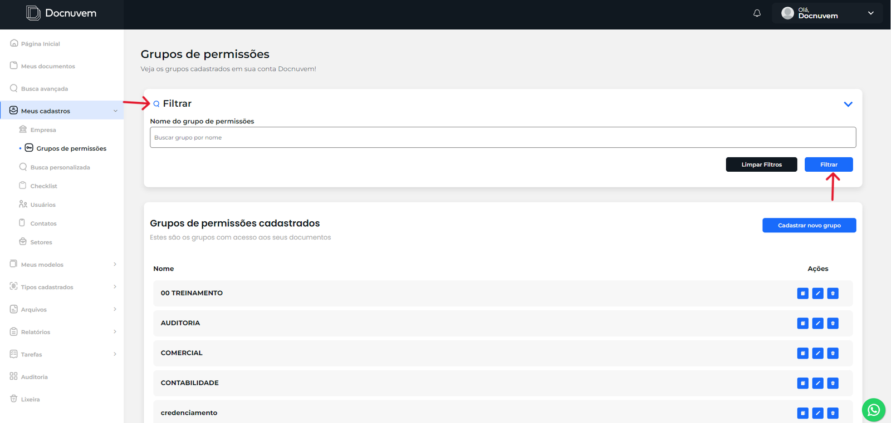

2. Na coluna **Ações**, clique no ícone de lixeira do grupo.

    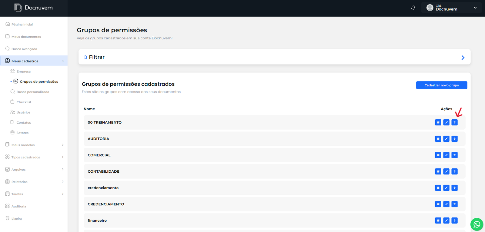

3. Na notificação exibida, confirme a exclusão.

**Resultado esperado:** o grupo é removido da listagem.

## Setores

O cadastro de **Setores** permite categorizar registros por áreas da empresa, como vendas, financeiro, suporte ou outros departamentos, facilitando a visualização e o gerenciamento das informações.

### Como cadastrar um Setor

1. Acesse **Meus cadastros** → **Setores**.

    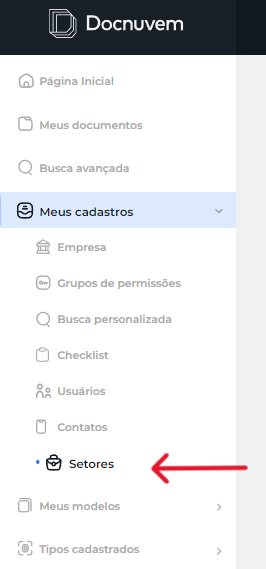

2. Na listagem, clique em **Cadastrar novo setor**.

    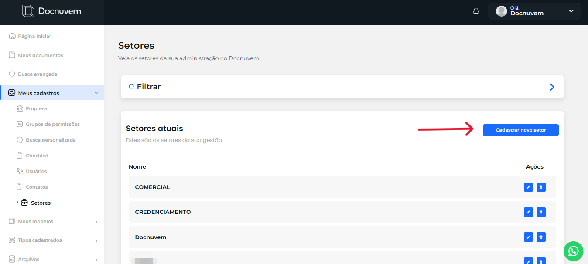

3. Informe o nome do setor.

    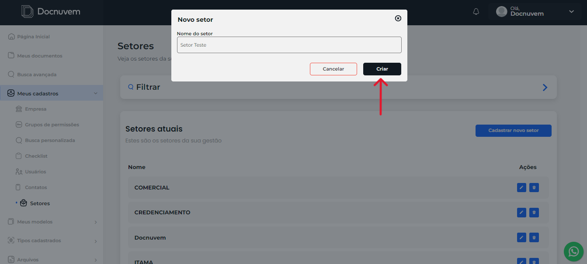

4. Clique em **Criar** para concluir o cadastro.

**Resultado esperado:** o setor fica disponível para uso no Docnuvem.

### Como editar um Setor

1. Acesse **Meus cadastros** → **Setores**.
2. Clique no balão **Filtrar**, informe o nome do setor e clique em **Filtrar**.

    

3. Na coluna **Ações**, clique no ícone de lápis do setor.

    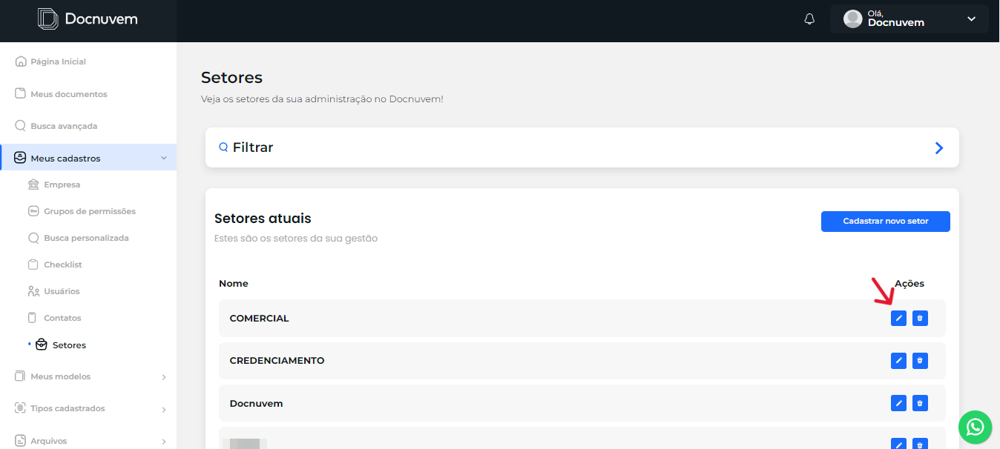

4. Atualize as informações e clique em **Salvar** ou **Criar**, conforme a ação exibida na tela.

**Resultado esperado:** o setor passa a usar as informações atualizadas.

### Como excluir um Setor

1. Acesse a listagem de **Setores** e use o balão **Filtrar** para encontrar o registro.

    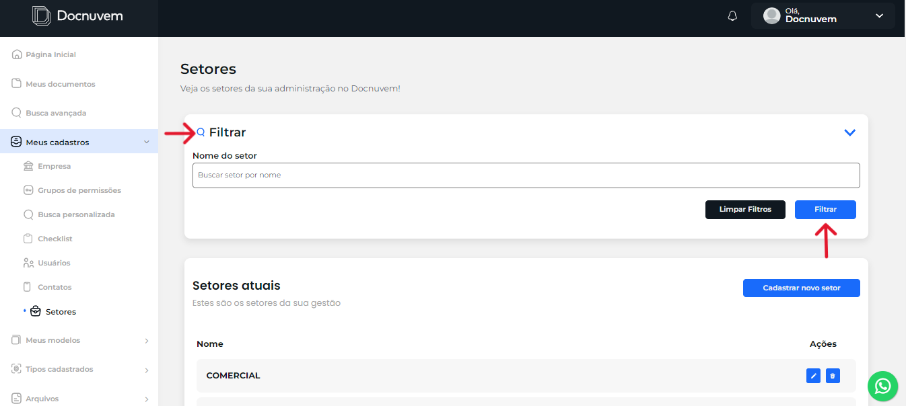

2. Na coluna **Ações**, clique no ícone de lixeira do setor.

    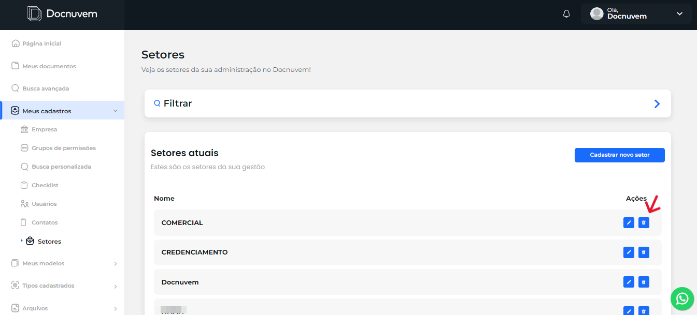

3. Na notificação exibida, confirme a exclusão.

**Resultado esperado:** o setor é removido da listagem.

## Contatos

O cadastro de **Contatos** mantém dados de pessoas e empresas que podem participar de solicitações e outros processos do Docnuvem. Mantenha as informações atualizadas para evitar problemas ao enviar solicitações para os contatos.

### Como cadastrar um Contato

1. Acesse **Meus cadastros** → **Contatos**.

    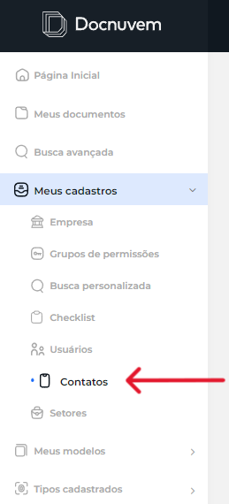

2. Na listagem, clique em **Cadastrar novo contato**.

    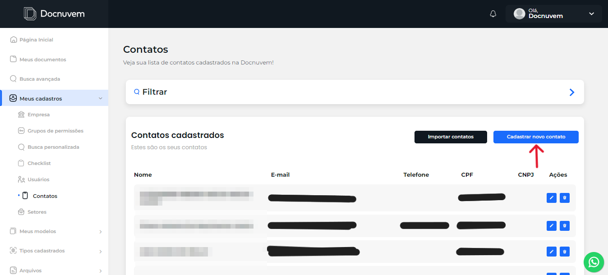

3. Informe os dados solicitados no formulário, conferindo principalmente os dados que serão usados em solicitações para o contato.

    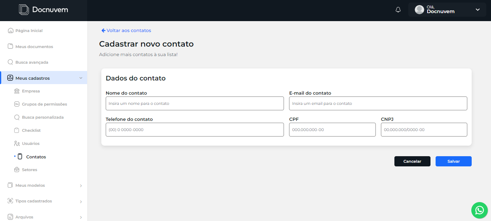

4. Clique em **Salvar**.

**Resultado esperado:** o contato fica cadastrado e disponível para uso nos processos do Docnuvem.

### Como importar Contatos

Use a importação para cadastrar vários contatos a partir de uma planilha.

1. Acesse **Meus cadastros** → **Contatos**.
2. Clique em **Importar contatos**.

    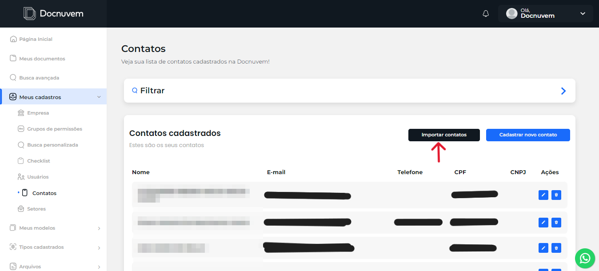

3. Na tela de importação, clique em **Baixar planilha padrão** — use-a como modelo para preencher os dados no formato esperado pelo Docnuvem.

    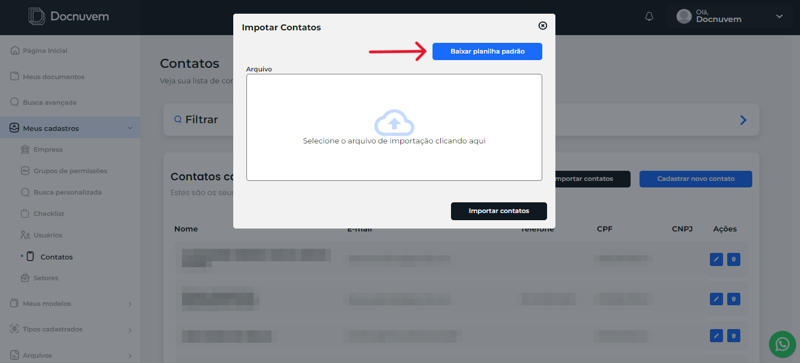

4. Preencha a planilha com os contatos a importar. Os campos **Telefone do contato**, **CPF** e **CNPJ** devem seguir suas respectivas máscaras (pontos, barras, traços ou parênteses, quando aplicável).
5. Selecione o arquivo preenchido no campo de importação e clique em **Importar contatos**.

    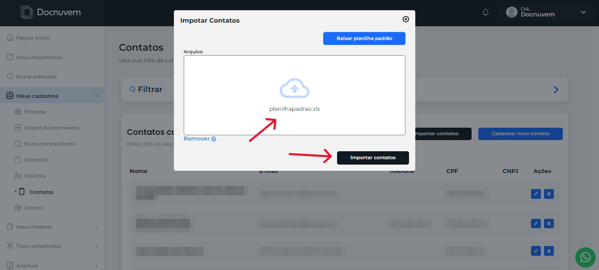

6. Confira a mensagem exibida pelo sistema informando se os contatos foram importados. Se a importação não for concluída, revise a planilha e confira se todos os dados foram informados corretamente.

**Resultado esperado:** os contatos da planilha são adicionados à listagem de contatos.

### Como editar um Contato

1. Acesse **Meus cadastros** → **Contatos** (ou **Voltar aos contatos**, se já estiver no cadastro).
2. Clique no balão **Filtrar**, informe os critérios de busca e clique em **Filtrar**.

    

3. Na coluna **Ações**, clique no ícone de lápis do contato.

    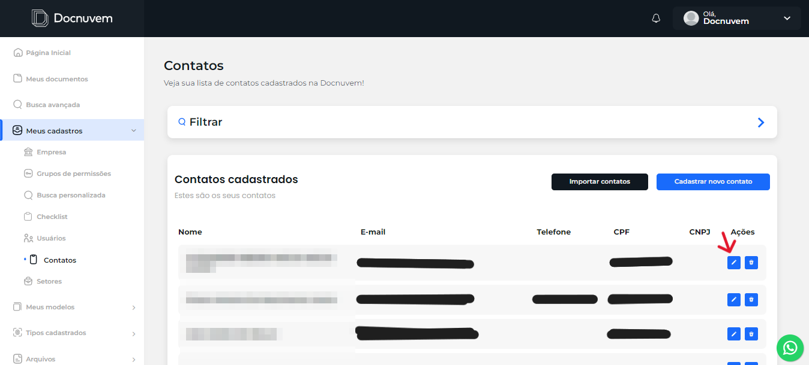

4. Atualize as informações necessárias e clique em **Salvar**.

**Resultado esperado:** o contato passa a usar os dados atualizados.

### Como excluir um Contato

1. Acesse a listagem de **Contatos** e use o balão **Filtrar** para encontrar o registro.

    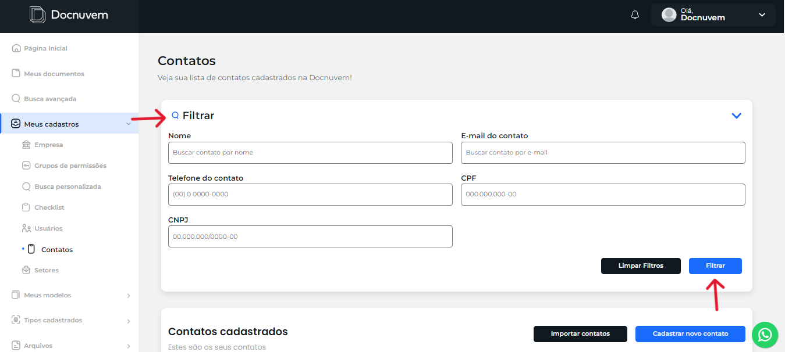

2. Na coluna **Ações**, clique no ícone de lixeira do contato.

    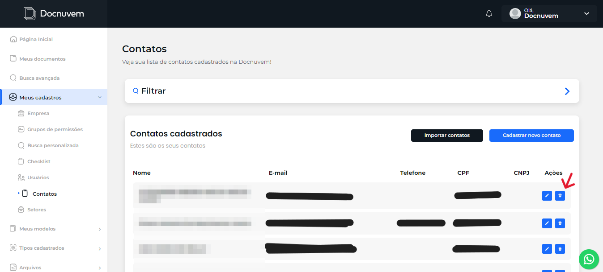

3. Na notificação exibida, confirme a exclusão.

**Resultado esperado:** o contato é removido da listagem.

## Cadastro de Empresas, ARs e Agências

Permite manter uma base organizada de registros empresariais no Docnuvem, centralizando dados, contatos, certificados, colaboradores, diretórios e limites de assinatura mensal.

!!! info "Importante"
    O nome exibido no menu pode variar conforme a configuração da instância: em algumas instalações o cadastro aparece como **Empresa**; em outras, como **AR** ou **Agência**.

### Como cadastrar uma Empresa, AR ou Agência

1. Acesse **Meus cadastros** e clique em **Empresa**, **AR** ou **Agência**, conforme o nome configurado na instância.

    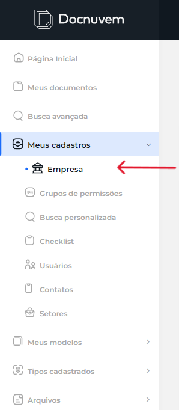

2. Na listagem, clique em **Cadastrar nova Empresa**, **Cadastrar nova AR** ou **Cadastrar nova Agência**.

    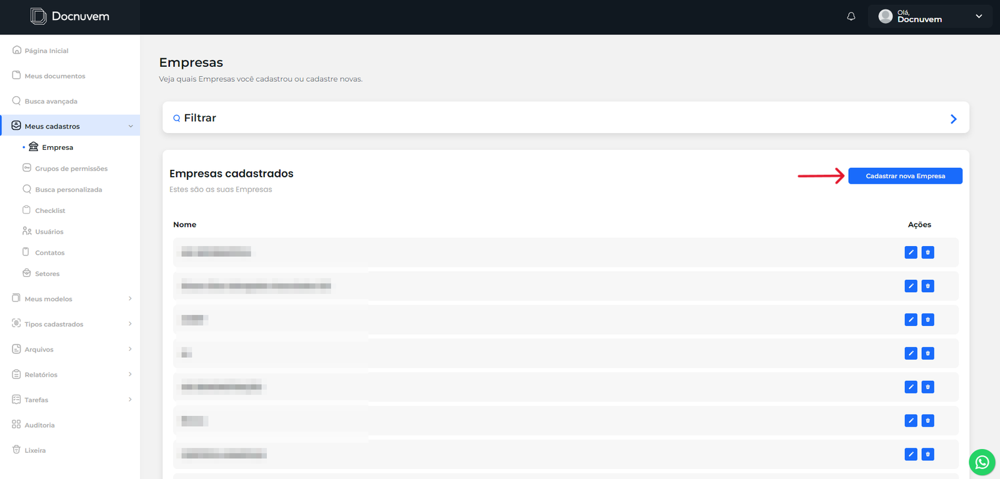

3. Na aba principal, informe os dados da empresa, AR ou agência. Para incluir **Endereço**, **Telefone** ou **E-mail**, clique no balão correspondente e depois em **Adicionar**.

    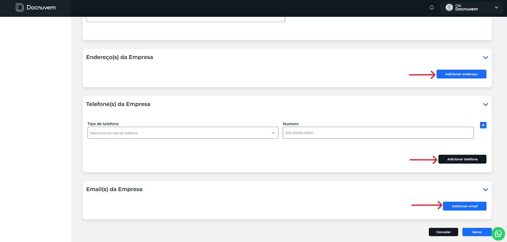

4. Na aba **Certificado**, arraste o arquivo do certificado para a área indicada, ou clique na área de importação para selecioná-lo no computador.

    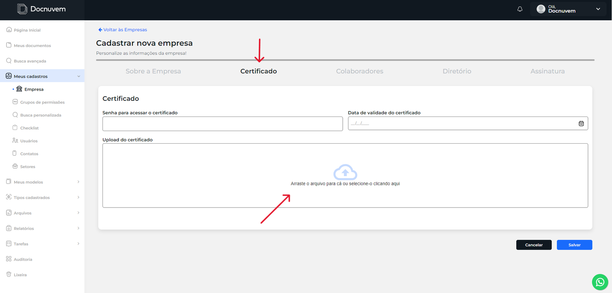

5. Na aba **Colaboradores**, adicione os colaboradores vinculados ao registro. Após informar os dados do colaborador, preencha o campo **Nome da pasta** para definir como ele será criado na estrutura padrão da empresa.

    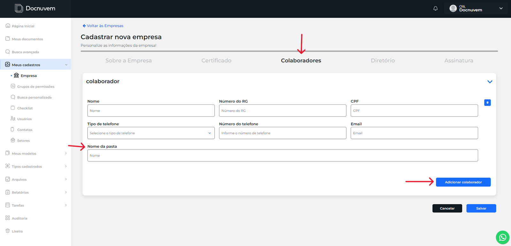

6. Na aba **Diretório**, defina o **Diretório raiz**, o **Modelo de diretório** e o diretório dos funcionários — essas informações determinam onde a empresa e os colaboradores serão criados na estrutura de diretórios.

    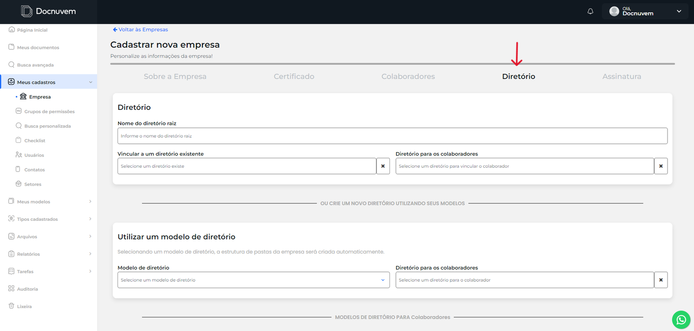

7. Se necessário, defina a quantidade máxima de assinaturas mensais permitidas (esse limite pode ser alterado depois, ao editar o registro).

    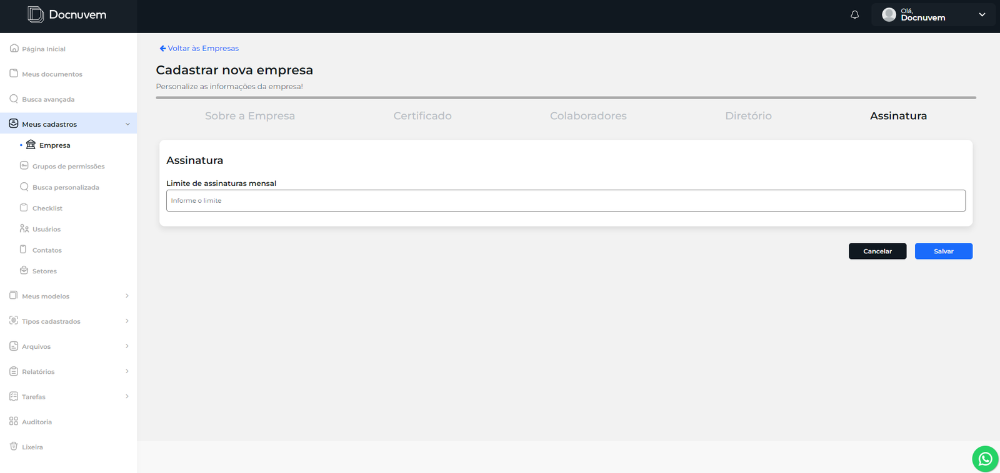

8. Revise as informações e clique em **Salvar**.

**Resultado esperado:** o registro fica disponível na listagem e pode ser usado nos processos relacionados à empresa, AR ou agência.

### Como editar uma Empresa, AR ou Agência

1. Acesse **Meus cadastros** → **Empresa** / **AR** / **Agência** (ou **Voltar às Empresas** / **ARs** / **Agências**, se já estiver no cadastro).
2. Clique no balão **Filtrar**, informe os critérios de busca e clique em **Filtrar**.

    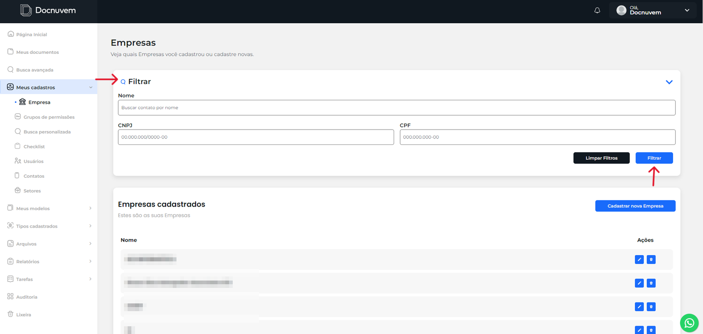

3. Na coluna **Ações**, clique no ícone de lápis do registro.

    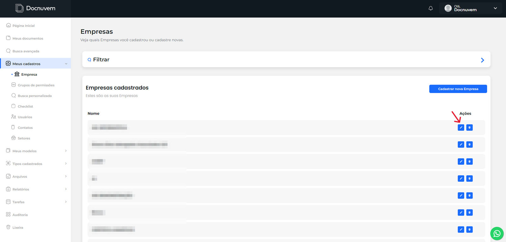

4. Atualize as informações necessárias e clique em **Salvar**.

**Resultado esperado:** as alterações ficam salvas no registro selecionado.

### Como excluir uma Empresa, AR ou Agência

1. Acesse a listagem do cadastro e use o balão **Filtrar** para encontrar o registro.

    

2. Na coluna **Ações**, clique no ícone de lixeira do registro.

    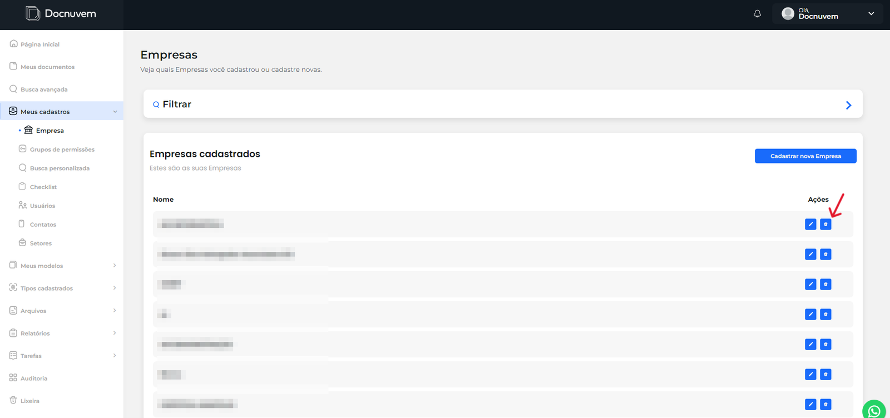

3. Na notificação exibida, confirme a exclusão.

**Resultado esperado:** o registro é removido da listagem.

## Formulários

O cadastro de **Formulários** cria estruturas de campos para registrar informações de documentos que não foram gerados por processos internos da plataforma. Use formulários para padronizar dados, controlar vencimentos e facilitar a consulta de informações vinculadas a documentos.

### Como cadastrar um Formulário

1. Acesse **Meus cadastros** → **Formulário**.

    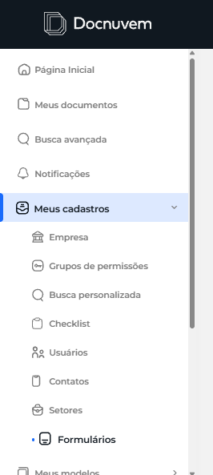

2. Na listagem, clique em **Cadastrar novo formulário**.

    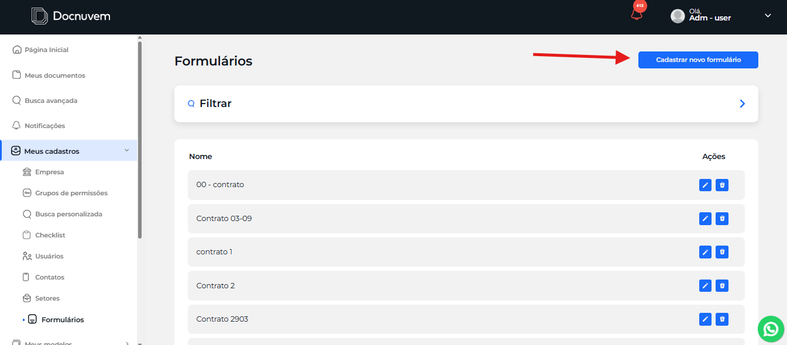

3. Informe o **Nome**, o **Intervalo em dias para alerta de vencimento** e a **Descrição**.

    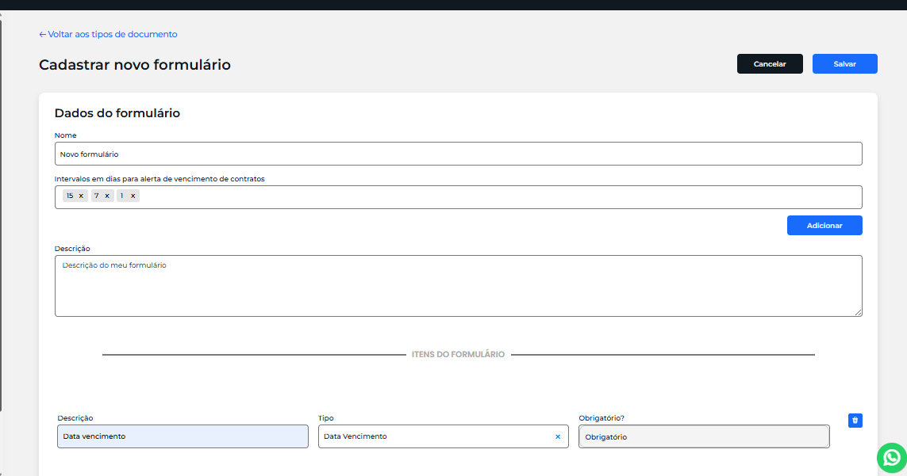

4. Antes de salvar, clique em **Adicionar** para inserir os itens do formulário — para cada item, informe a descrição, escolha o tipo de campo e indique se o preenchimento será obrigatório.

    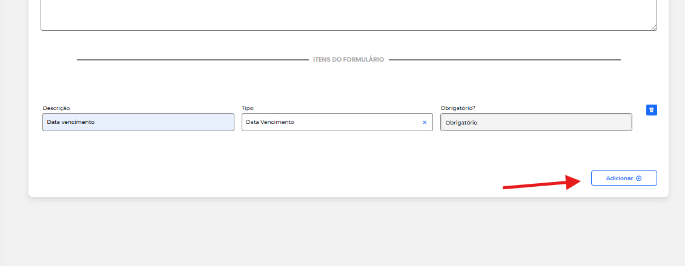

5. Clique em **Salvar**.

**Resultado esperado:** o formulário fica cadastrado e pode ser vinculado a documentos para registro de informações complementares.

### Como editar um Formulário

1. Acesse **Meus cadastros** → **Formulário** (ou **Voltar aos formulários**, se já estiver no cadastro).
2. Clique no balão **Filtrar**, informe o nome do formulário e clique em **Filtrar**.

    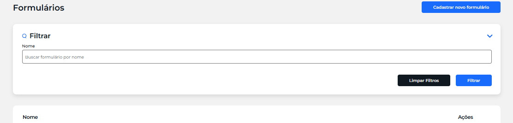

3. Na coluna **Ações**, clique no ícone de lápis do formulário.

    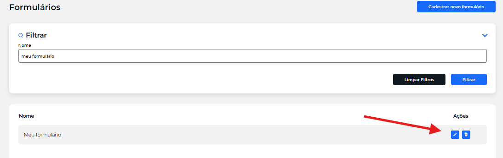

4. Atualize as informações necessárias e clique em **Salvar**.

**Resultado esperado:** o formulário passa a usar as informações atualizadas.

### Como excluir um Formulário

1. Acesse a listagem de **Formulário** e use o balão **Filtrar** para encontrar o registro.

    

2. Na coluna **Ações**, clique no ícone de lixeira do formulário.

    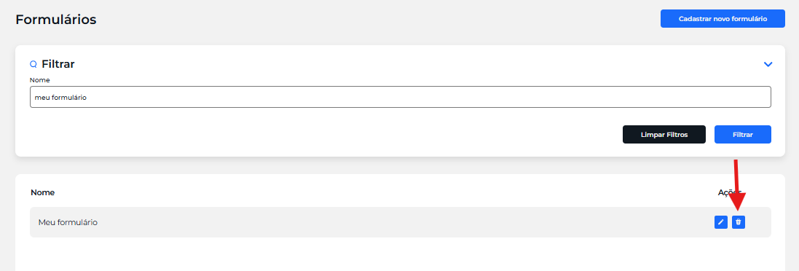

3. Na notificação exibida, confirme a exclusão.

**Resultado esperado:** o formulário é removido da listagem.

## Checklist

O cadastro de **Checklist** cria listas de verificação para organizar tarefas, validar informações e acompanhar preenchimentos. Um checklist pode ter responsáveis, itens obrigatórios e opções de progresso, conforme a necessidade do processo.

### Como cadastrar um Checklist

1. Acesse **Meus cadastros** → **Checklist**.

    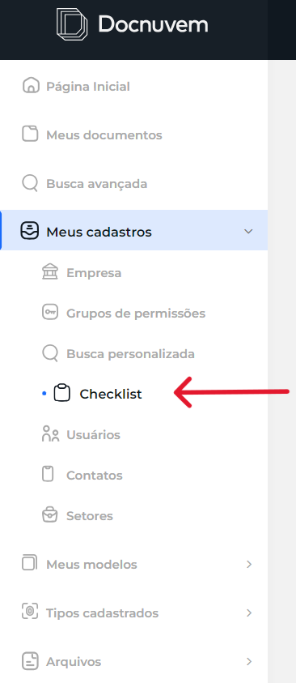

2. Na listagem, clique em **Cadastrar novo checklist**.

    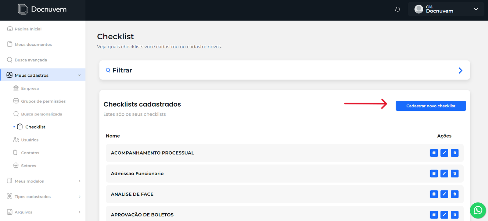

3. Informe o **Nome**, o **Tipo de documento** e a **Descrição**, e defina se o checklist estará **Ativo**, se será **Privado** e se terá **Progresso**.

    

4. Antes de salvar, clique em **Adicionar** para inserir os itens — para cada um, informe a descrição, defina se poderá ser exportado, escolha o tipo de campo e indique se o preenchimento será obrigatório.

    

5. Clique em **Adicionar** na área de responsáveis e selecione o usuário responsável pelo checklist.

    

6. Para remover um item ou responsável antes de salvar, clique no ícone de lixeira ao lado do campo correspondente.

    

7. Após adicionar itens e responsáveis, clique em **Salvar**.

!!! warning "Importante"
    Itens só podem ser removidos **antes do primeiro salvamento** do checklist. Depois de salvo, os itens não podem mais ser adicionados ou removidos — em caso de dúvida, entre em contato com o suporte.

**Resultado esperado:** o checklist fica cadastrado e disponível para uso nos processos do Docnuvem.

### Como editar um Checklist

1. Acesse **Meus cadastros** → **Checklist** (ou **Voltar aos checklists**, se já estiver no cadastro).
2. Clique no balão **Filtrar**, informe os critérios desejados e clique em **Filtrar**.

    

3. Na coluna **Ações**, clique no ícone de lápis do checklist.

    

4. Atualize as informações permitidas e clique em **Salvar**.

**Resultado esperado:** as informações do checklist são atualizadas.

### Como excluir um Checklist

1. Acesse a listagem de **Checklist** e use o balão **Filtrar** para encontrar o registro.

    

2. Na coluna **Ações**, clique no ícone de lixeira do checklist.

    

3. Na notificação exibida, confirme a exclusão.

**Resultado esperado:** o checklist é removido da listagem.

## Busca personalizada

O cadastro de **Busca personalizada** salva combinações de filtros para reutilização na [Busca avançada](05-busca-avancada.md). Use esta funcionalidade quando a equipe faz consultas recorrentes e precisa evitar configurar os mesmos filtros a cada pesquisa.

### Como cadastrar uma Busca personalizada

1. Acesse **Meus cadastros** → **Busca personalizada**.

    

2. Na listagem, clique em **Cadastrar nova busca**.

    

3. Na aba **Geral**, informe um nome claro para a busca, que facilite identificá-la na Busca avançada.

    

4. Nas abas **Arquivos** e **Diretórios**, selecione os filtros que devem compor a busca personalizada. Configure apenas os critérios necessários — quanto mais específico o filtro, mais restrito o resultado.

    

    

5. Revise o nome e os filtros e clique em **Salvar**.

**Resultado esperado:** a busca personalizada fica cadastrada e disponível na aba **Busca personalizada** da [Busca avançada](05-busca-avancada.md).

### Como editar uma Busca personalizada

1. Acesse **Meus cadastros** → **Busca personalizada** (ou **Voltar às buscas personalizadas**, se já estiver no cadastro).
2. Clique no balão **Filtrar**, informe o nome da busca e clique em **Filtrar**.

    

3. Na coluna **Ações**, clique no ícone de lápis da busca personalizada.

    

4. Atualize o nome ou os filtros nas abas **Geral**, **Arquivos** e **Diretórios** e clique em **Salvar**.

**Resultado esperado:** a busca personalizada passa a usar os filtros atualizados.

### Como excluir uma Busca personalizada

1. Acesse a listagem de **Busca personalizada** e use o balão **Filtrar** para encontrar o registro.

    

2. Na coluna **Ações**, clique no ícone de lixeira da busca personalizada.

    

3. Na notificação exibida, confirme a exclusão.

**Resultado esperado:** a busca personalizada é removida da listagem.

## Veja também

- [Tipos Cadastrados](09-tipos-cadastrados.md) — cadastros de Tipo de documento e Tipo de metadado.
- [Busca Avançada](05-busca-avancada.md) — onde as buscas personalizadas são utilizadas.
