# Meus Modelos

O módulo **Meus modelos** reúne configurações reutilizáveis para padronizar diretórios, documentos e solicitações no Docnuvem: **Modelo de diretório**, **Modelo de documento** e **Modelo de solicitação**.

## Modelo de diretório

Permite criar estruturas de pastas padronizadas e reutilizáveis. Use modelos de diretório para manter a organização de setores, projetos ou empresas, evitando recriar manualmente a mesma hierarquia de pastas em diferentes contextos.

### Como cadastrar um Modelo de diretório

1. No menu principal, acesse **Meus modelos** e clique em **Modelo de diretório**.

    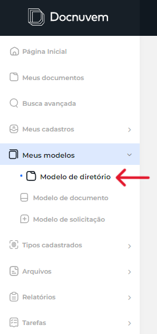

2. Na listagem, clique em **Cadastrar novo modelo**.

    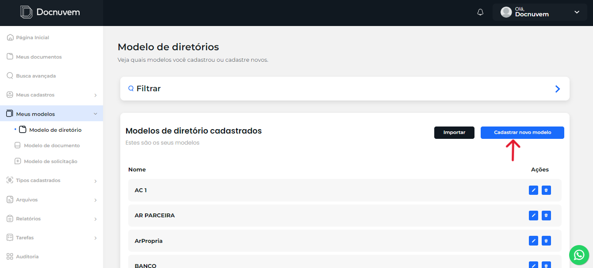

3. Defina o nome do modelo — use um nome claro para identificar a estrutura, como o nome de um setor, projeto ou padrão empresarial.

    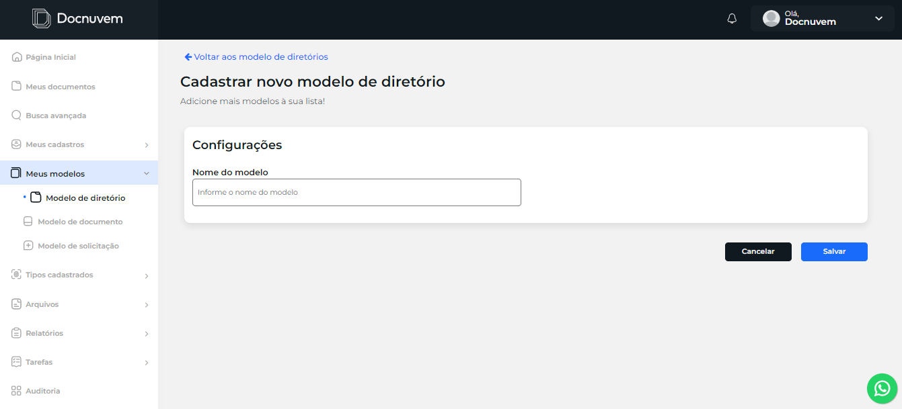

4. Clique em **Salvar**. Após salvar, o sistema retorna à listagem de modelos de diretório.
5. Na listagem, selecione o modelo criado para configurar sua estrutura de pastas. Ao abrir o modelo, o sistema exibe um balão com o nome do modelo e o botão **Ações**.

    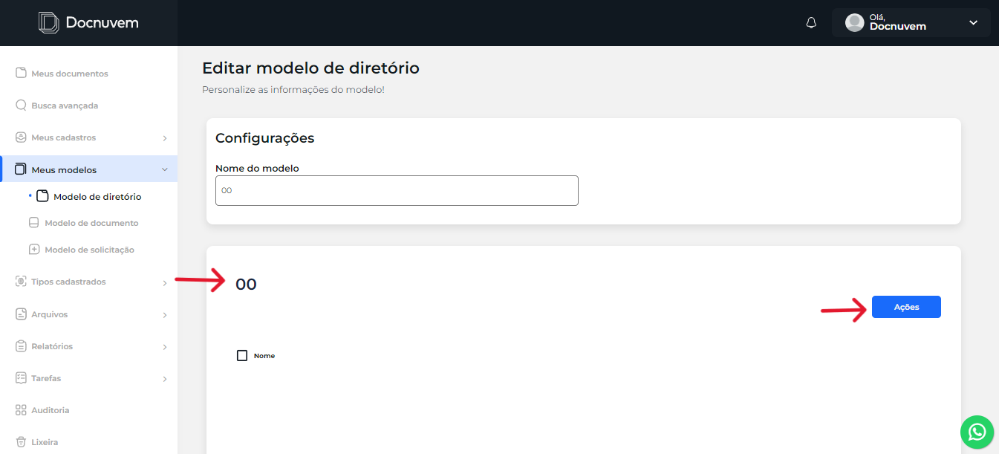

**Resultado esperado:** o modelo de diretório fica criado e pronto para receber a estrutura de pastas.

### Como configurar pastas no Modelo de diretório

1. Acesse a listagem de **Modelo de diretório** e selecione o modelo a configurar.
2. Clique em **Ações** para ver as opções disponíveis — criar, remover e renomear pastas, além de configurar regras de **Envio Inteligente** para as pastas do modelo.

    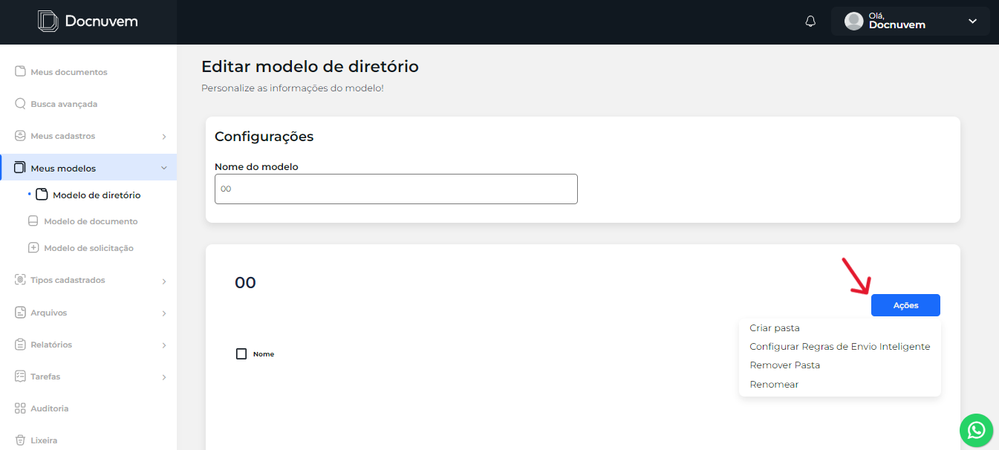

3. Para criar uma pasta, clique em **Ações** → **Criar pasta**, informe o nome na janela exibida e clique em **Criar pasta**.

    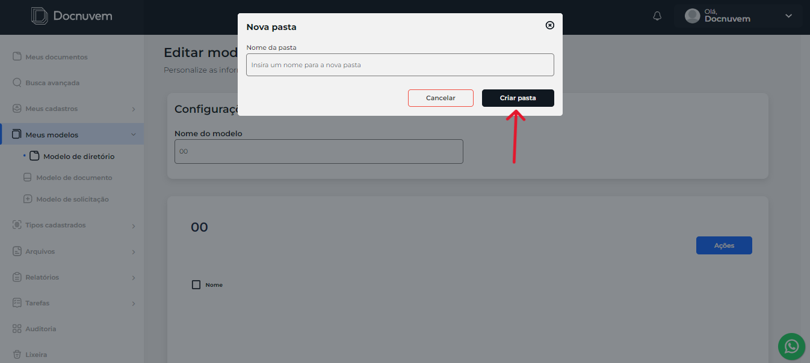

4. Para criar uma subpasta, clique sobre o nome da pasta pai e repita o processo de criação de pasta.

    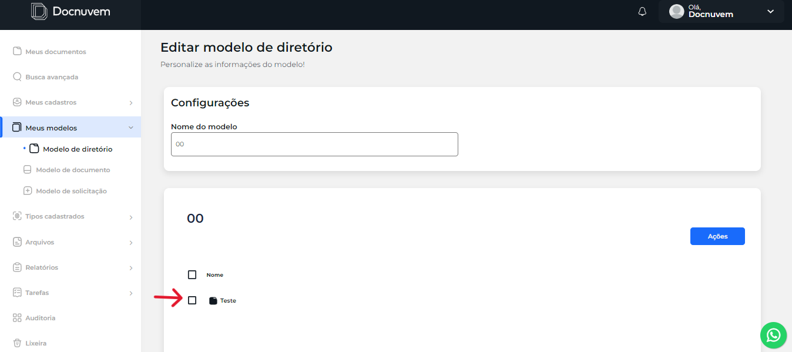

5. Para renomear ou excluir uma pasta, selecione-a pelo checkbox ao lado do ícone da pasta, clique em **Ações** e escolha a opção correspondente.

    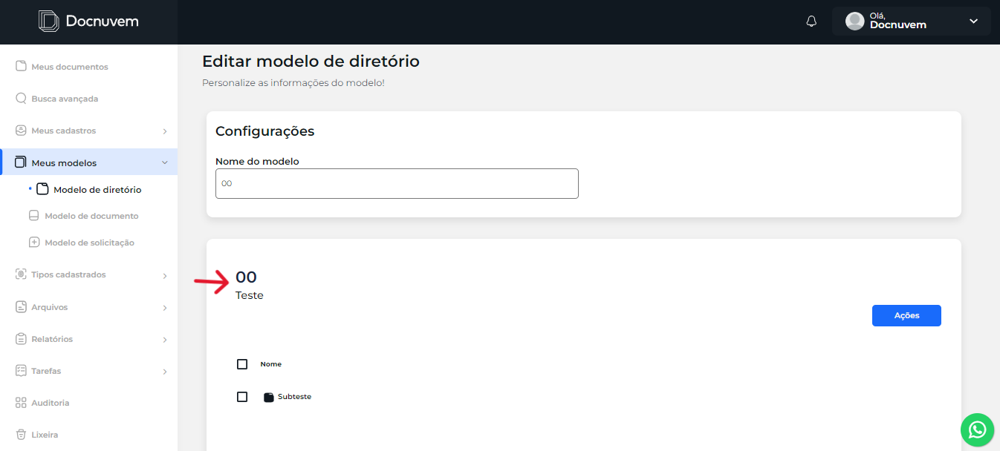

**Resultado esperado:** a estrutura do modelo fica organizada com as pastas e subpastas necessárias.

### Como importar um Modelo de diretório

Use a importação para criar um modelo a partir de uma estrutura de pastas já existente em [Meus Documentos](04-meus-documentos.md).

1. Na tela de modelo de diretório, clique em **Importar**.

    

2. O sistema lista os diretórios que estão na raiz de Meus documentos. Clique no diretório pai que contém a estrutura a importar.

    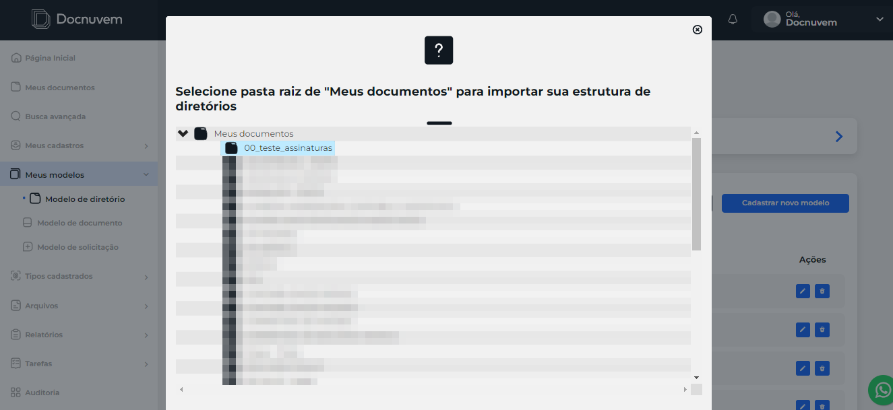

3. Conclua a importação conforme a confirmação exibida pelo sistema.

**Resultado esperado:** a hierarquia de pastas selecionada é importada para o modelo de diretório.

### Como editar um Modelo de diretório

1. Acesse **Meus modelos** → **Modelo de diretório** (ou **Voltar aos modelos de diretórios**, se já estiver no cadastro).
2. Clique no balão **Filtrar**, informe o nome do modelo e clique em **Filtrar**.

    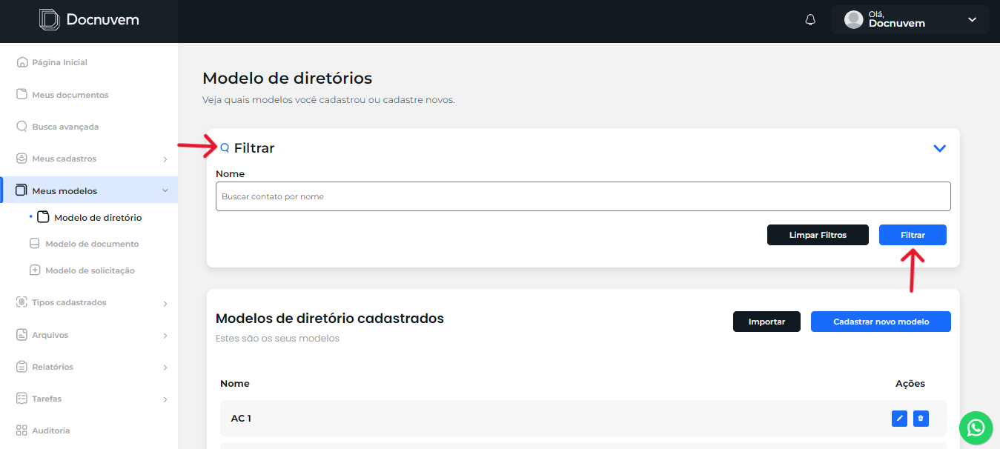

3. Na coluna **Ações**, clique no ícone de lápis do modelo.

    

4. Atualize as informações necessárias e clique em **Salvar**.

**Resultado esperado:** o modelo de diretório passa a usar as informações atualizadas.

### Como excluir um Modelo de diretório

1. Acesse a listagem de **Modelo de diretório** e use o balão **Filtrar** para encontrar o registro.

    

2. Na coluna **Ações**, clique no ícone de lixeira do modelo.

    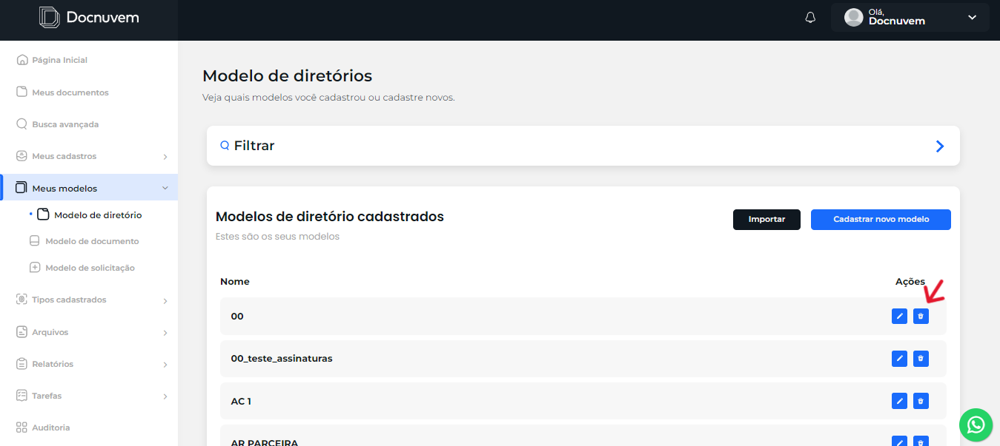

3. Na notificação exibida, confirme a exclusão.

**Resultado esperado:** o modelo de diretório é removido da listagem.

## Modelo de documento

Permite padronizar a criação de documentos com informações semelhantes. Com um modelo pré-definido, o usuário preenche campos estruturados e o sistema gera o documento conforme o template configurado.

### Como cadastrar um Modelo de documento

1. Acesse **Meus modelos** → **Modelo de documento**.

    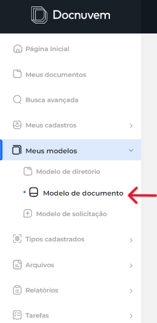

2. Na listagem, clique em **Cadastrar novo modelo**.

    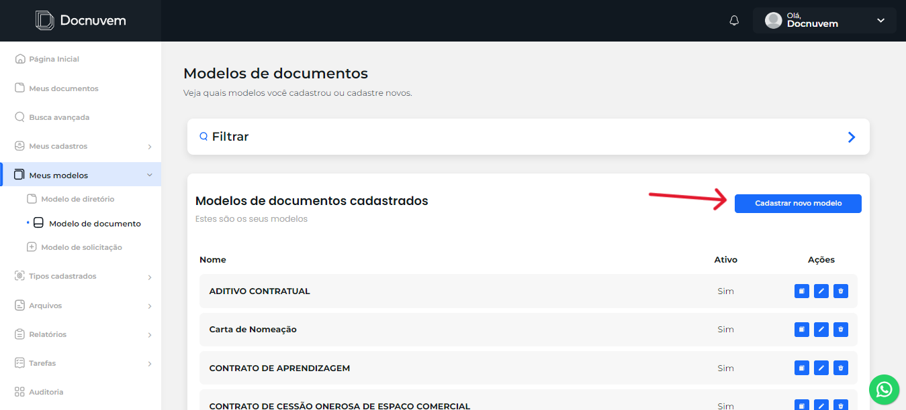

3. Informe os dados do modelo: **Nome**, **Descrição** e, se necessário, o **Tipo de Documento** associado.

    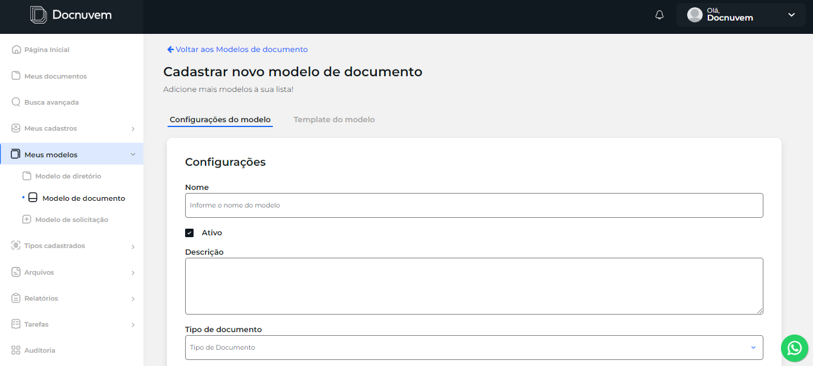

4. Configure o conteúdo do modelo — itens, arquivos solicitados, usuários e setores autorizados e o template do documento (veja as seções abaixo).
5. Revise as configurações e clique em **Salvar**.

**Resultado esperado:** o modelo fica disponível para criação de documentos padronizados.

### Como configurar itens no Modelo de documento

Os itens do modelo representam os campos que o usuário preencherá ao criar um documento a partir do modelo.

1. Na área de itens do modelo, clique em **Adicionar**.

    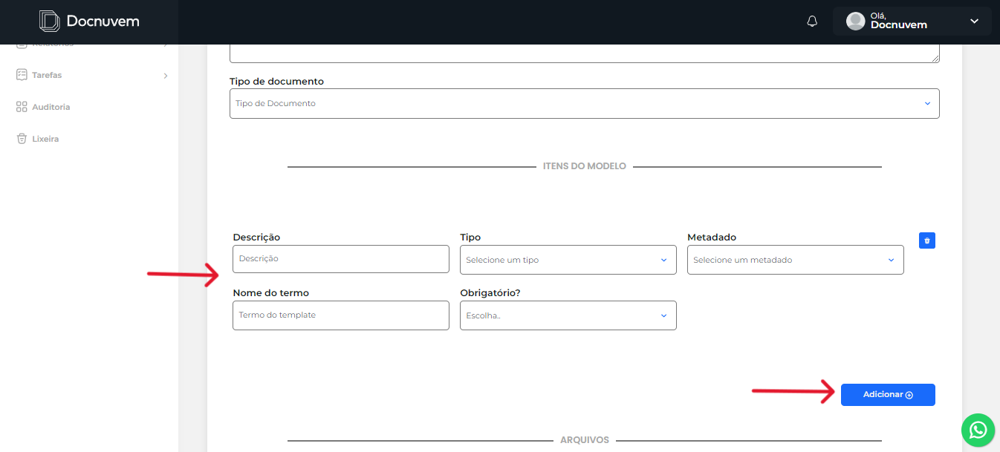

2. Preencha a descrição do item — ela será exibida ao usuário durante o preenchimento do documento.
3. Selecione o tipo do item. Entre os mais usados estão **Caixa de texto**, **Data** e **Caixa de seleção múltipla**.
4. Se necessário, selecione o metadado associado ao item e informe o **Nome do termo**, que será usado como TAG no template do documento.

    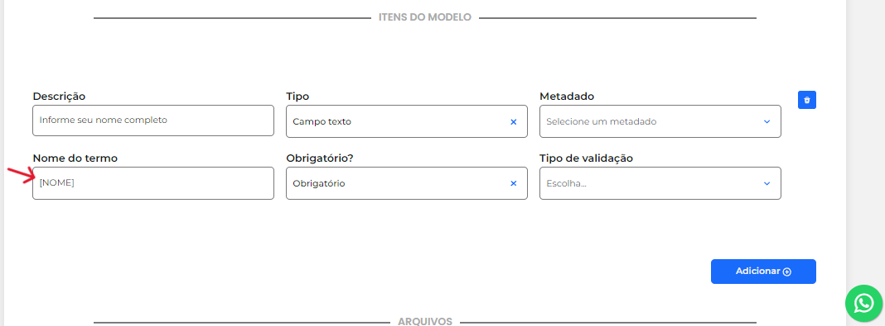

5. Marque se o item será de preenchimento obrigatório.

**Resultado esperado:** o item fica configurado para preenchimento durante a criação do documento.

### Como configurar arquivos no Modelo de documento

Use arquivos no modelo quando o documento gerado precisar receber anexos durante o preenchimento.

1. Na área de arquivos, clique em **Adicionar** — os arquivos enviados durante o preenchimento serão adicionados ao final do documento.

    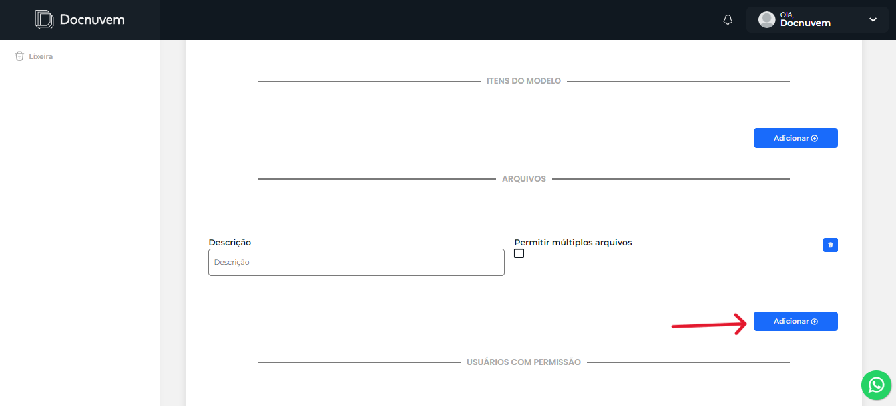

2. Preencha a descrição que será exibida ao usuário na fase de preenchimento.

    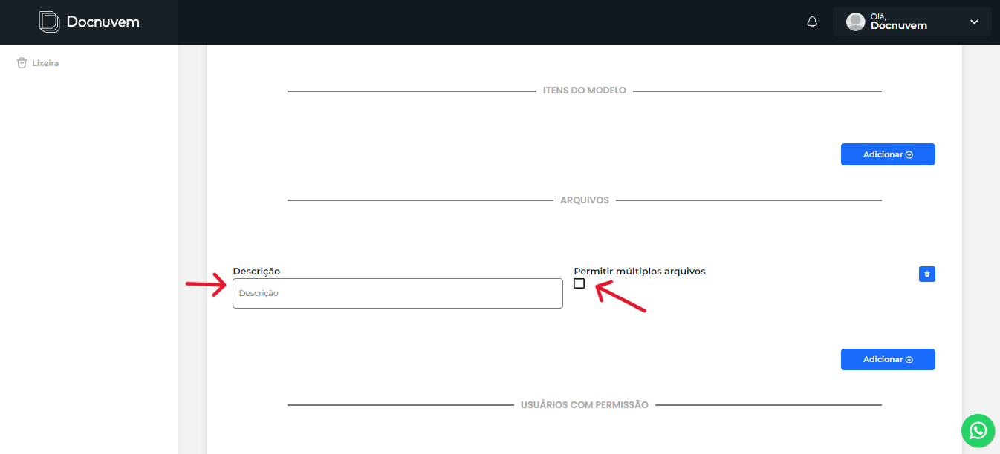

3. Para permitir mais de um anexo no mesmo campo, marque **Permitir múltiplos arquivos**.

**Resultado esperado:** o modelo passa a solicitar arquivos durante o preenchimento do documento.

### Como configurar usuários e setores no Modelo de documento

Use as permissões do modelo para definir quem poderá criar documentos a partir dele.

1. Na área de usuários autorizados, clique em **Adicionar** e selecione o usuário entre os cadastrados no sistema.

    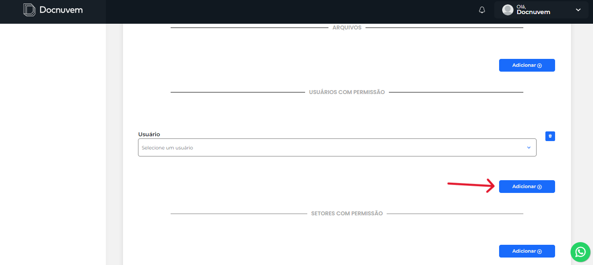

2. Na área de setores autorizados, clique em **Adicionar** e selecione um setor cadastrado no sistema.

    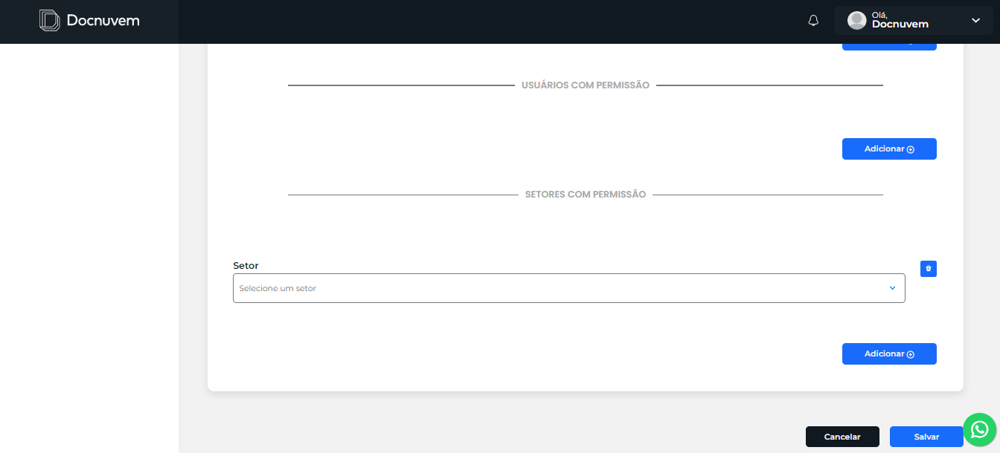

**Resultado esperado:** a criação de documentos pelo modelo fica limitada aos usuários e setores autorizados.

### Como editar o template do Modelo de documento

O template define a aparência e a estrutura do documento que será gerado pelo modelo.

1. No cadastro do modelo, abra a aba **Template do modelo**.

    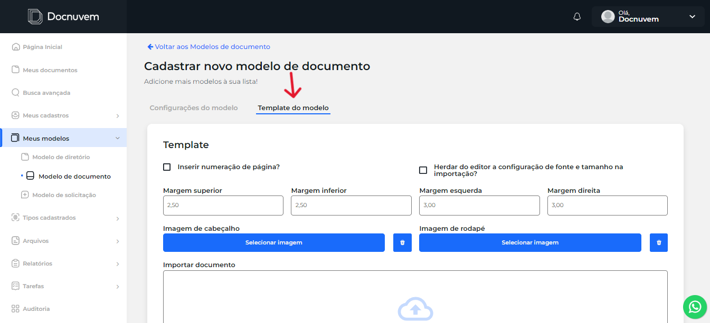

2. Use o editor para escrever e formatar o documento — número de páginas, fonte, espaçamento e outras opções de formatação.

    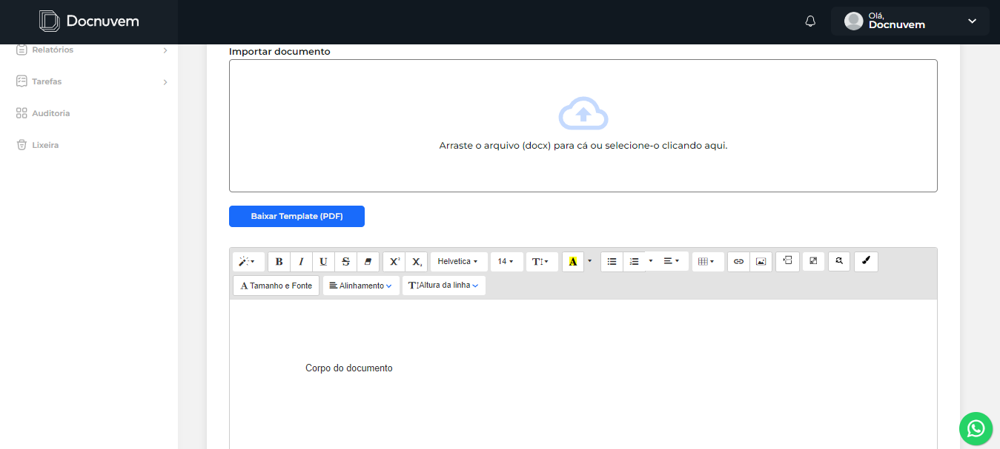

3. Para adicionar imagens no cabeçalho ou no rodapé, clique em **Selecionar imagem**.

    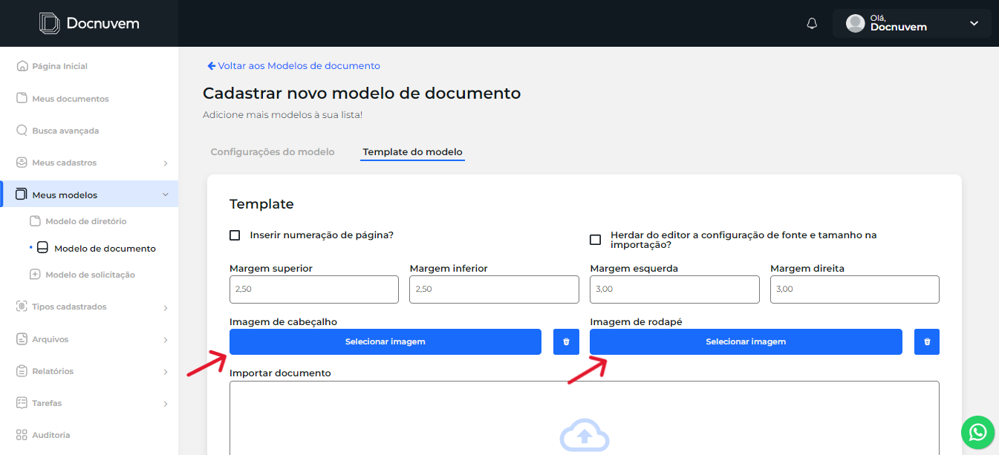

4. Para inserir no template os itens criados no modelo, use o **Nome do termo** configurado em cada item. As TAGs devem ser escritas exatamente como foram definidas no cadastro do item.

    ![TAG [NOME] inserida no template do documento.](images/meus-modelos/como-editar-o-template-do-modelo-de-documento/04-tags-no-template.png)

5. Para itens do tipo **Caixa de seleção múltipla**, insira a TAG abaixo da descrição correspondente no template.

**Resultado esperado:** o template fica pronto para gerar documentos com os dados preenchidos pelos usuários.

### Como editar um Modelo de documento

1. Acesse **Meus modelos** → **Modelo de documento** (ou **Voltar aos Modelos de documento**, se já estiver no cadastro).
2. Clique no balão **Filtrar**, informe os critérios de busca e clique em **Filtrar**.

    

3. Na coluna **Ações**, clique no ícone de lápis do modelo.

    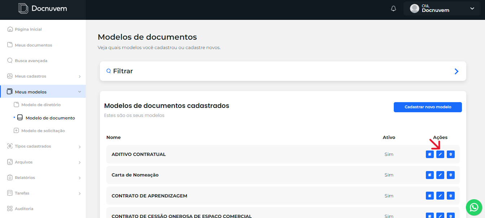

4. Atualize as informações necessárias e clique em **Salvar**.

**Resultado esperado:** o modelo de documento passa a usar as informações atualizadas.

### Como excluir um Modelo de documento

1. Acesse a listagem de **Modelo de documento** e use o balão **Filtrar** para encontrar o registro.

    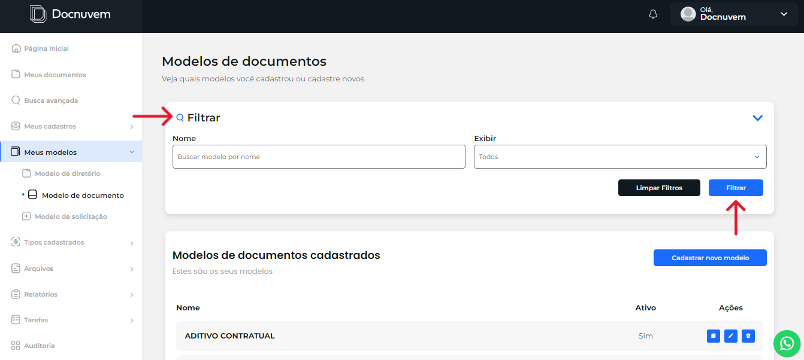

2. Na coluna **Ações**, clique no ícone de lixeira do modelo.

    

3. Na notificação exibida, confirme a exclusão.

**Resultado esperado:** o modelo de documento é removido da listagem.

## Modelo de solicitação

Permite padronizar solicitações de documentos. Use esta funcionalidade para definir previamente quais documentos serão solicitados, por quanto tempo a solicitação ficará disponível e como os arquivos recebidos serão organizados.

### Como cadastrar um Modelo de solicitação

1. Acesse **Meus modelos** → **Modelo de solicitação**.

    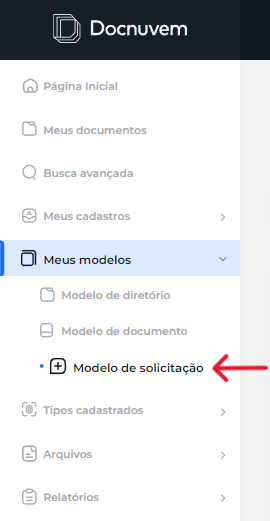

2. Na listagem, clique em **Cadastrar novo modelo**.

    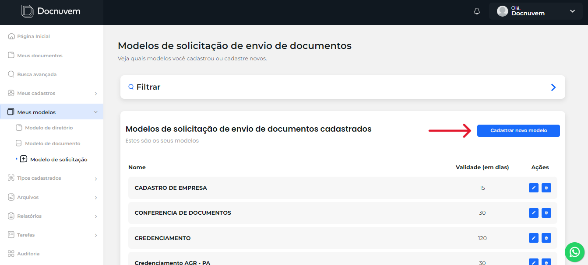

3. Defina o nome do modelo e a quantidade de dias em que a solicitação ficará disponível.

    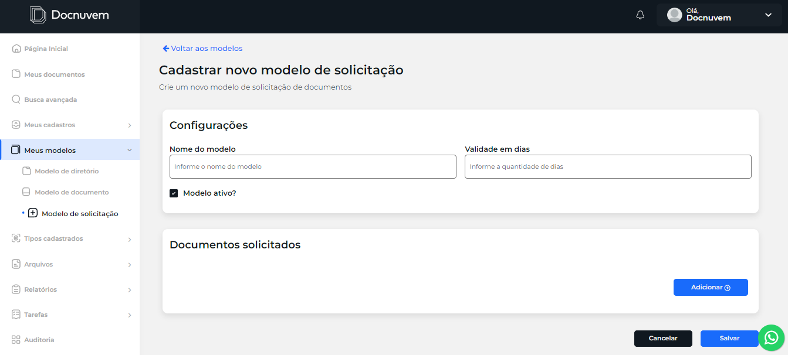

4. Clique em **Adicionar** para inserir um documento solicitado. Para cada documento, informe a descrição, a subpasta onde o arquivo será salvo, se o envio será obrigatório e se a pessoa poderá enviar mais de um arquivo para esse documento.

    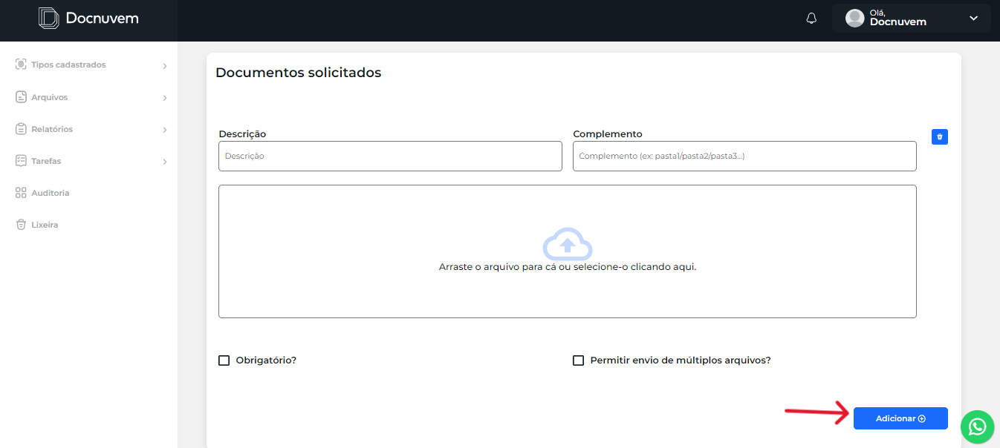

5. Revise os dados e documentos solicitados e clique em **Salvar**.

**Resultado esperado:** o modelo fica disponível para uso em solicitações de documentos e agendamentos de solicitação.

### Como editar um Modelo de solicitação

1. Acesse **Meus modelos** → **Modelo de solicitação** (ou **Voltar aos modelos**, se já estiver no cadastro).
2. Clique no balão **Filtrar**, informe os critérios de busca e clique em **Filtrar**.

    

3. Na coluna **Ações**, clique no ícone de lápis do modelo.

    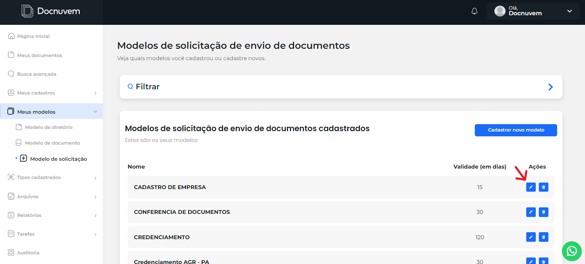

4. Atualize as informações necessárias e clique em **Salvar**.

**Resultado esperado:** o modelo de solicitação passa a usar as informações atualizadas.

### Como excluir um Modelo de solicitação

1. Acesse a listagem de **Modelo de solicitação** e use o balão **Filtrar** para encontrar o registro.

    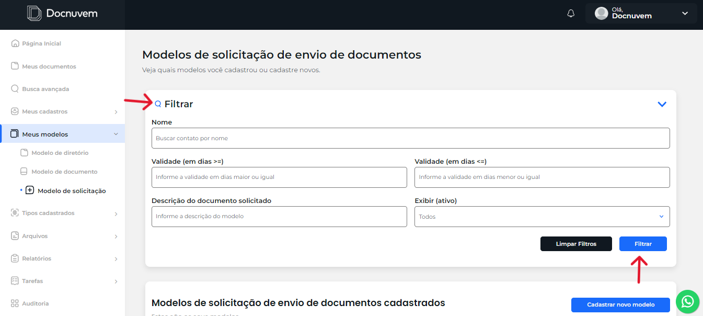

2. Na coluna **Ações**, clique no ícone de lixeira do modelo.

    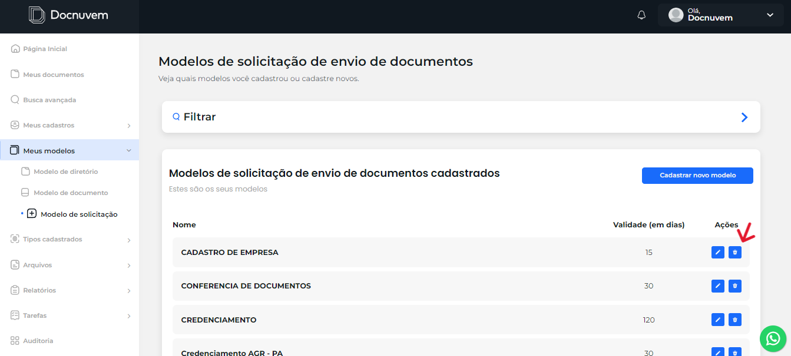

3. Na notificação exibida, confirme a exclusão.

**Resultado esperado:** o modelo de solicitação é removido da listagem.

## Veja também

- [Meus Documentos](04-meus-documentos.md) — onde os modelos de diretório e de solicitação são aplicados no dia a dia.
- [Tipos Cadastrados](09-tipos-cadastrados.md) — tipos e metadados usados nos modelos de documento.
