# Tipos Cadastrados

O módulo **Tipos cadastrados** reúne os cadastros de **Tipo de documento** e **Tipo de metadado**, usados para classificar documentos e definir informações complementares no Docnuvem.

## Tipo de documento

O **Tipo de documento** permite classificar documentos e definir informações complementares, como metadados e configurações de assinatura. Use este cadastro para manter os documentos organizados, facilitar buscas e aplicar regras específicas conforme a natureza de cada arquivo.

### Como cadastrar um Tipo de documento

1. No menu principal, acesse **Tipos cadastrados** e clique em **Tipo de documento**.

    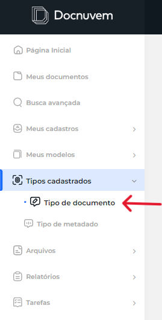

2. Na tela de listagem, clique em **Cadastrar novo tipo**.

    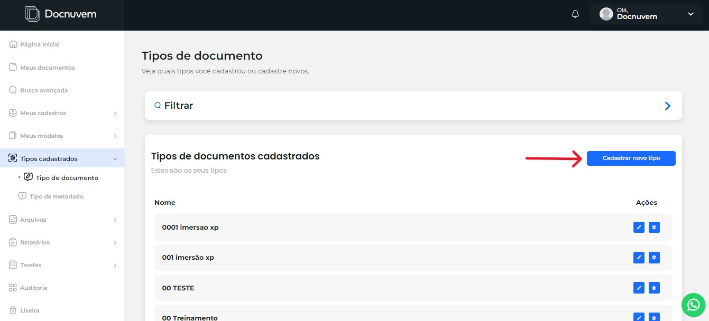

3. Na aba **Configurações gerais**, preencha o nome e as demais informações do tipo de documento.

    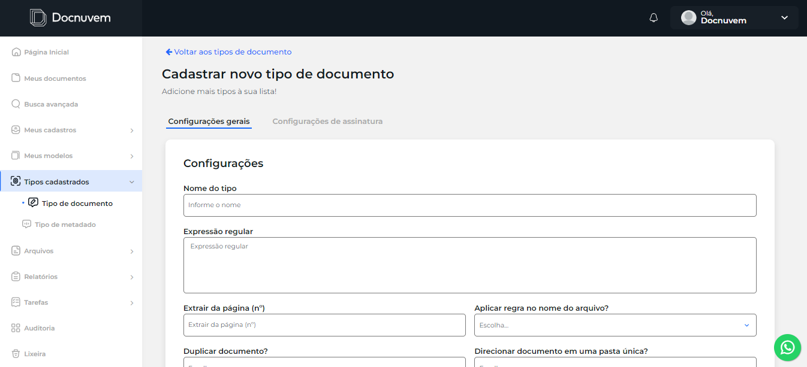

4. Na área de metadados, clique em **Adicionar**. Os metadados definem informações adicionais que podem ser associadas aos documentos desse tipo e usadas em organização, busca e relatórios.

    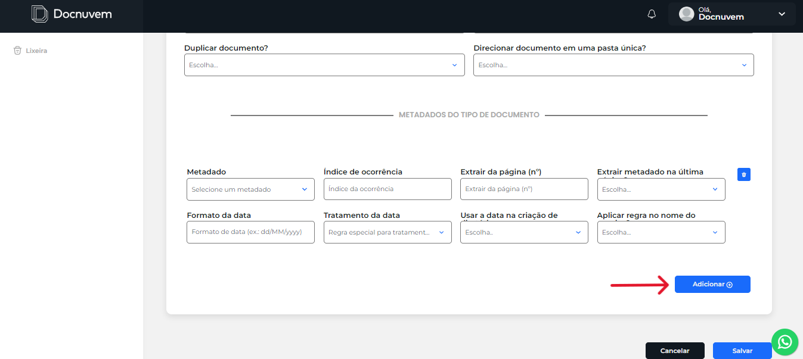

5. Para cada metadado, preencha os campos necessários e defina sua formatação e configuração conforme a necessidade do tipo de documento.
6. Revise as informações e clique em **Salvar**.

**Resultado esperado:** o tipo de documento fica cadastrado e pode ser associado a documentos, modelos e outros processos do Docnuvem.

### Como configurar assinatura no Tipo de documento

Use as configurações de assinatura para definir comportamentos padrão quando um documento desse tipo for enviado para assinatura.

1. No cadastro do tipo de documento, abra a aba **Configurações de assinatura**.

    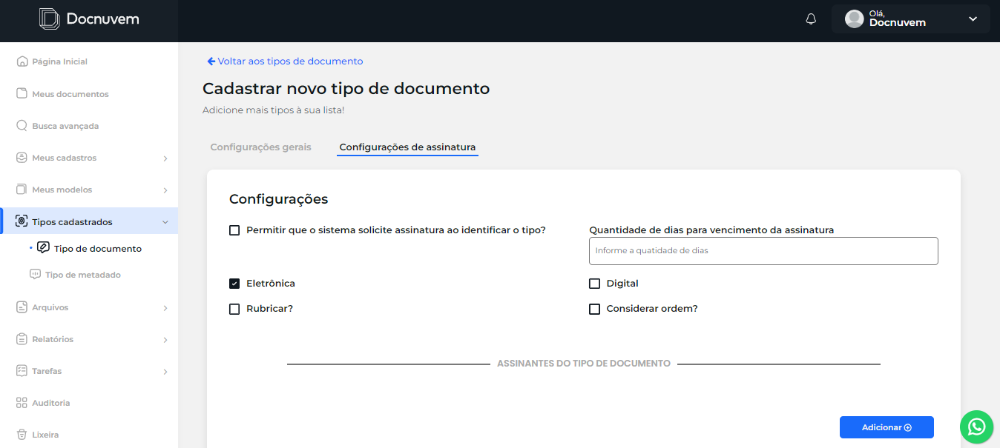

2. Configure as opções de assinatura disponíveis: permitir a solicitação ao identificar o tipo do documento, definir a quantidade de dias para vencimento da assinatura, escolher o tipo de assinatura padrão, exigir rubrica e considerar a ordem de assinatura.
3. Para adicionar assinantes padrão ao tipo de documento, clique em **Adicionar** e selecione um usuário já cadastrado no sistema.

    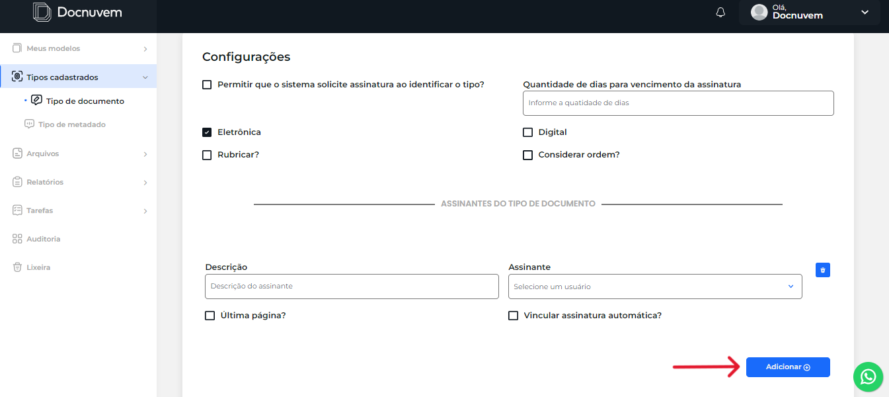

4. Revise as regras de assinatura e os assinantes e clique em **Salvar**.

**Resultado esperado:** quando um documento desse tipo for enviado para assinatura, o Docnuvem aplica as configurações definidas.

### Como editar um Tipo de documento

1. No menu principal, acesse **Tipos cadastrados** e clique em **Tipo de documento** (ou, se já estiver na tela de cadastro, clique em **Voltar aos tipos de documento**).
2. Clique no balão **Filtrar**, informe os critérios de busca desejados e clique em **Filtrar**.

    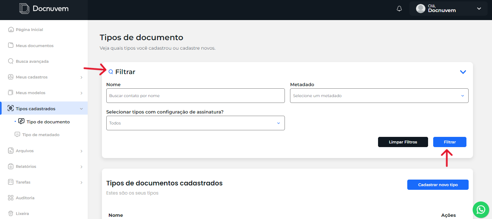

3. Na coluna **Ações**, clique no ícone de lápis do tipo de documento.

    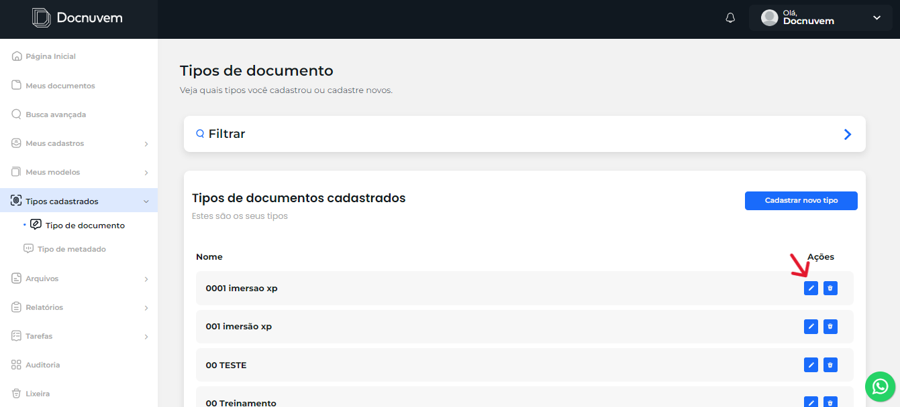

4. Atualize as informações necessárias e clique em **Salvar**.

**Resultado esperado:** o tipo de documento passa a usar as informações atualizadas.

### Como excluir um Tipo de documento

1. Acesse a listagem de **Tipo de documento** e use o balão **Filtrar** para encontrar o registro.

    

2. Na coluna **Ações**, clique no ícone de lixeira do tipo de documento.

    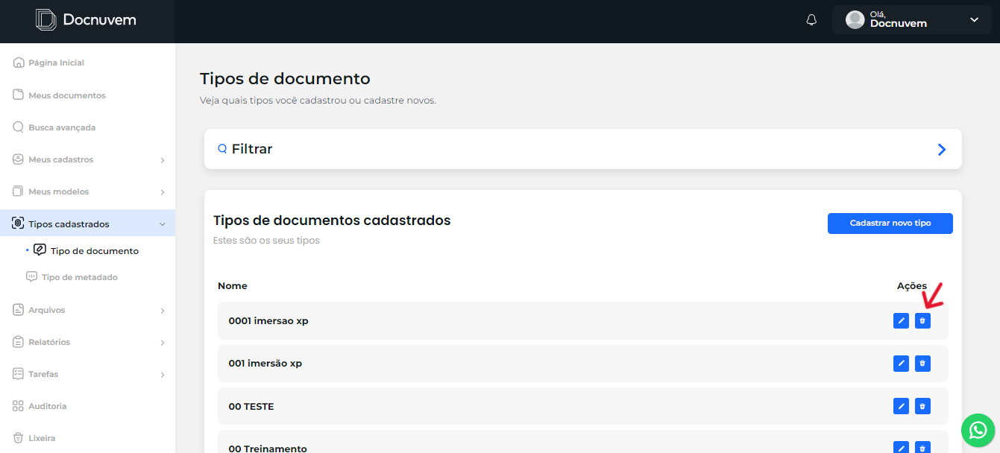

3. Na notificação exibida pelo sistema, confirme a exclusão.

**Resultado esperado:** o tipo de documento é removido da listagem.

## Tipo de metadado

O **Tipo de metadado** permite criar informações complementares para registros e documentos no Docnuvem. Metadados ajudam a organizar os dados, melhorar as buscas, enriquecer relatórios e permitir análises mais detalhadas.

### Como cadastrar um Tipo de metadado

1. No menu principal, acesse **Tipos cadastrados** e clique em **Tipo de metadado**.

    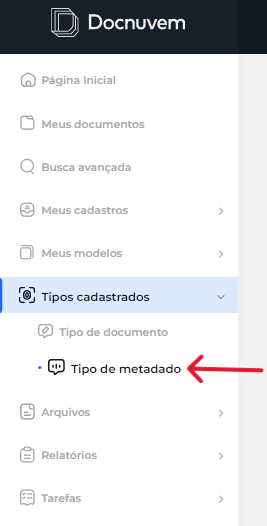

2. Na tela de listagem, clique em **Cadastrar novo metadado**.

    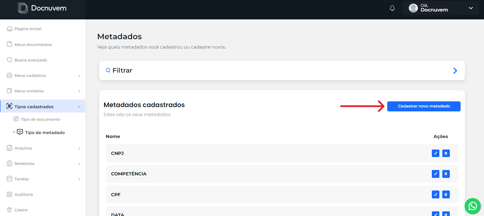

3. Informe o nome do metadado e selecione o tipo de metadado — o sistema já disponibiliza tipos padrão para uso no cadastro.

    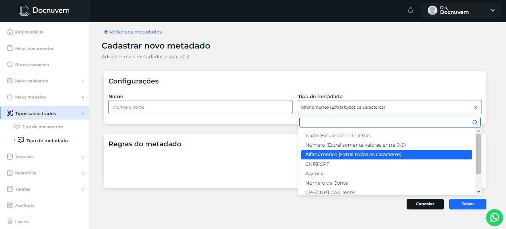

4. Após selecionar o tipo, preencha as regras aplicáveis. Para adicionar uma regra, clique em **Adicionar** na área de regras de metadados.

    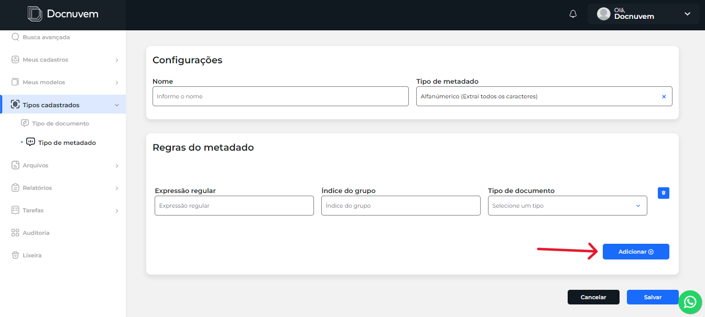

5. Revise o nome, o tipo e as regras configuradas e clique em **Salvar**.

**Resultado esperado:** o tipo de metadado fica cadastrado e pode ser usado em tipos de documento e outros registros compatíveis.

### Como editar um Tipo de metadado

1. No menu principal, acesse **Tipos cadastrados** e clique em **Tipo de metadado** (ou, se já estiver na tela de cadastro, clique em **Voltar aos metadados**).
2. Clique no balão **Filtrar**, informe o nome do metadado e clique em **Filtrar**.

    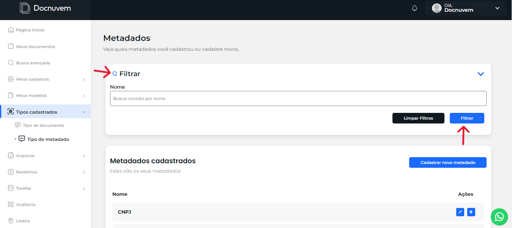

3. Na coluna **Ações**, clique no ícone de lápis do metadado.

    

4. Atualize as informações necessárias e clique em **Salvar**.

**Resultado esperado:** o tipo de metadado passa a usar as informações atualizadas.

### Como excluir um Tipo de metadado

1. Acesse a listagem de **Tipo de metadado** e use o balão **Filtrar** para encontrar o registro.

    

2. Na coluna **Ações**, clique no ícone de lixeira do metadado.

    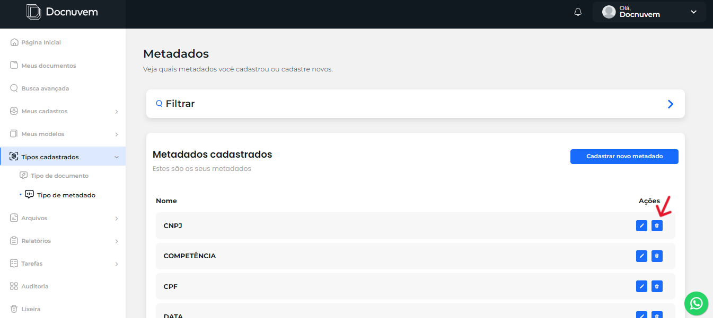

3. Na notificação exibida pelo sistema, confirme a exclusão.

**Resultado esperado:** o tipo de metadado é removido da listagem.

## Veja também

- [Meus Cadastros](07-meus-cadastros.md) — outros cadastros auxiliares do sistema (usuários, contatos, setores, permissões).
