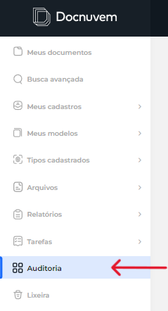
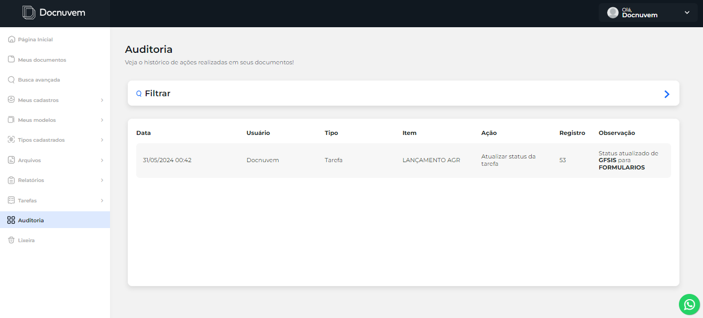
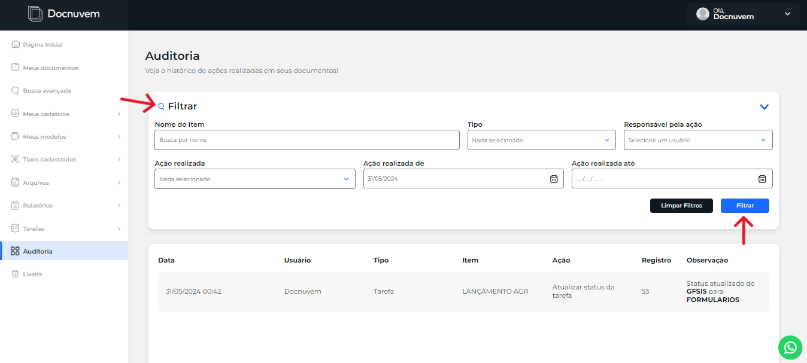

# Auditoria

A tela de **Auditoria** exibe o histórico de ações realizadas no Docnuvem, permitindo acompanhar o que foi executado na instância e por quem.

## Como visualizar o histórico de Auditoria

1. No menu principal, clique em **Auditoria**.

    

2. Na tela de Auditoria, consulte a listagem com o histórico de ações realizadas no sistema.

    

3. Cada entrada apresenta informações como data, hora, usuário responsável e ação realizada.

**Resultado esperado:** o usuário consegue acompanhar o histórico de atividades realizadas no Docnuvem.

## Como filtrar dados na Auditoria

1. Na tela de Auditoria, clique no balão **Filtrar**.

    

2. Informe os critérios desejados, como usuário, período ou outros campos disponíveis na tela.
3. Clique em **Filtrar** para atualizar a listagem.

**Resultado esperado:** a listagem passa a exibir apenas as ações compatíveis com os critérios informados.

## Veja também

- [Lixeira](13-lixeira.md) — recuperar ou remover permanentemente itens excluídos.
