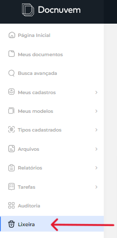
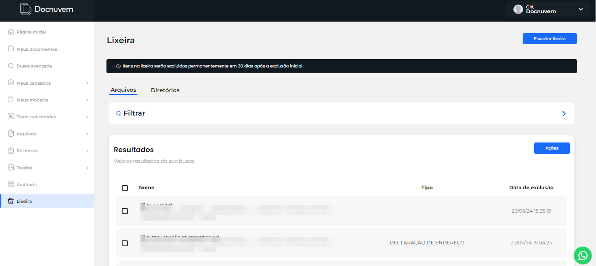
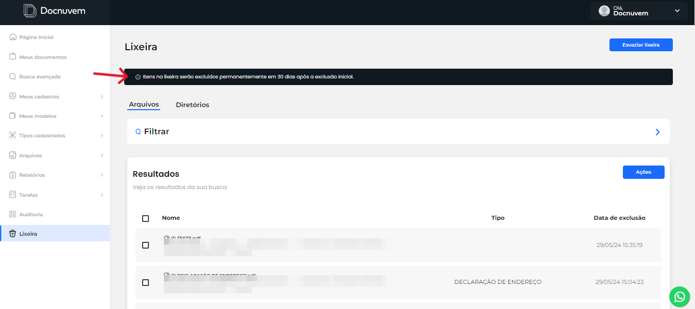
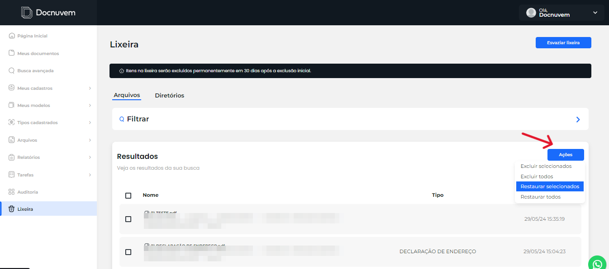
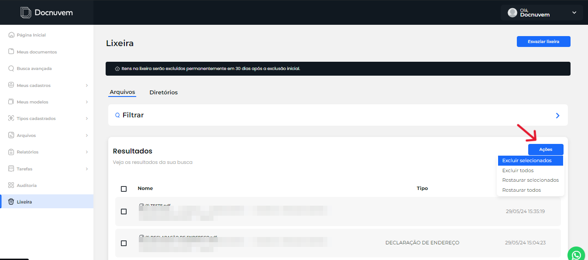

# Lixeira

A **Lixeira** reúne os arquivos e diretórios excluídos pelos usuários, permitindo restaurá-los ou removê-los definitivamente.

## Como visualizar itens na Lixeira

1. No menu principal, clique em **Lixeira**.

    

2. Na tela da Lixeira, consulte os arquivos e diretórios excluídos por usuários.

    

3. Confira o prazo de permanência: os itens ficam na Lixeira pelo prazo definido nas configurações da instância, normalmente entre 7 e 30 dias. A própria tela exibe uma mensagem informando o prazo configurado.

    

**Resultado esperado:** o usuário consegue visualizar os itens excluídos e saber por quanto tempo ficarão disponíveis para restauração.

## Como restaurar itens da Lixeira

1. Na tela da Lixeira, marque o checkbox ao lado dos arquivos ou diretórios que deseja restaurar.
2. Clique em **Ações**.

    

3. Selecione **Restaurar selecionados** para recuperar os itens marcados, ou **Restaurar todos** para restaurar tudo de uma vez.

**Resultado esperado:** os itens selecionados são restaurados e deixam de aparecer na Lixeira.

## Como excluir itens permanentemente da Lixeira

Use este procedimento para remover definitivamente arquivos ou diretórios antes do prazo de exclusão automática.

1. Na tela da Lixeira, marque o checkbox ao lado dos arquivos ou diretórios que deseja excluir permanentemente.
2. Clique em **Ações**.

    

3. Selecione **Excluir selecionados** para remover definitivamente os itens marcados, ou **Excluir todos** para excluir tudo de uma vez.

!!! warning "Importante"
    A exclusão permanente não pode ser desfeita. Confirme os itens marcados antes de prosseguir.

**Resultado esperado:** os itens selecionados são removidos permanentemente e não ficam mais disponíveis para restauração.

## Veja também

- [Auditoria](12-auditoria.md) — consultar quem executou uma ação no sistema.
