# Relatórios

O módulo de **Relatórios** oferece dados consolidados e métricas gerenciais sobre a utilização, solicitações, assinaturas e volume de documentos no Docnuvem.

Cada relatório tem uma tela própria, com filtros de busca e botões para exportar o resultado. Os relatórios gerados ficam registrados no **Histórico de relatórios exportados**, na própria tela.

Para abrir a lista de relatórios, clique em **Relatórios** no menu lateral.

## Relatório de Assinaturas

O relatório de **Assinaturas** exporta os dados das assinaturas solicitadas e realizadas nos documentos da instância, como as datas e o tipo de assinatura.

1. No menu principal, acesse **Relatórios** e clique em **Assinaturas**.

    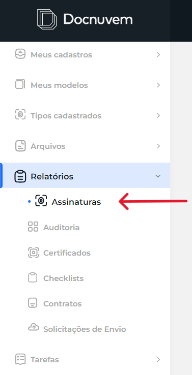

2. Na área **Exportar relatório**, preencha os filtros de busca desejados:
    - **Solicitação de** e **Solicitação até:** período em que a assinatura foi solicitada.
    - **Assinatura de** e **Assinatura até:** período em que a assinatura foi realizada.
    - **Tipo de assinatura:** filtra pelo tipo de assinatura utilizado.
    - **Tipo de ordenação:** define a ordem dos resultados. O padrão é **Data de Assinatura (Crescente)**.

    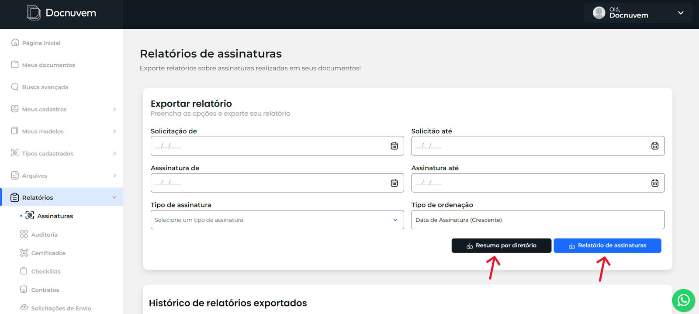

3. Escolha o tipo de relatório que deseja gerar:
    - **Relatório de assinaturas:** relatório mais detalhado, com os dados de cada assinatura.
    - **Resumo por diretório:** relatório resumido, com a quantidade de assinaturas por diretório.

4. Depois que o relatório é gerado e baixado, ele é adicionado ao **Histórico de relatórios exportados**, na parte de baixo da tela.

    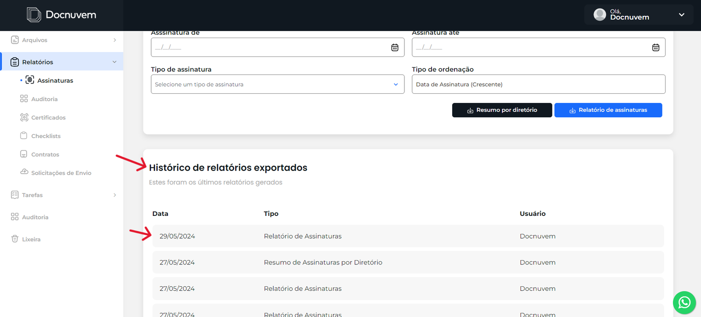

**Resultado esperado:** o relatório é gerado conforme os filtros informados e fica registrado no histórico de relatórios exportados.

## Relatório de Certificados

O relatório de **Certificados** exporta os dados dos certificados cadastrados, como a data de validade e o status.

1. No menu principal, acesse **Relatórios** e clique em **Certificados**.

    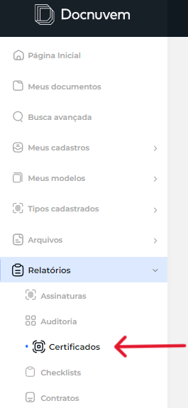

2. Na área **Exportar relatório**, preencha os filtros de busca desejados:
    - **Nome do certificado:** nome do arquivo do certificado.
    - **Nome da empresa:** empresa, AR ou agência a que o certificado pertence. O nome do campo acompanha o tipo de cadastro configurado na instância.
    - **Validade de** e **Validade até:** período de validade do certificado.
    - **Status:** situação do certificado, como vigente ou vencido.
    - **Ordenação:** define a ordem dos resultados. O padrão é **Data de Validade (Crescente)**.

    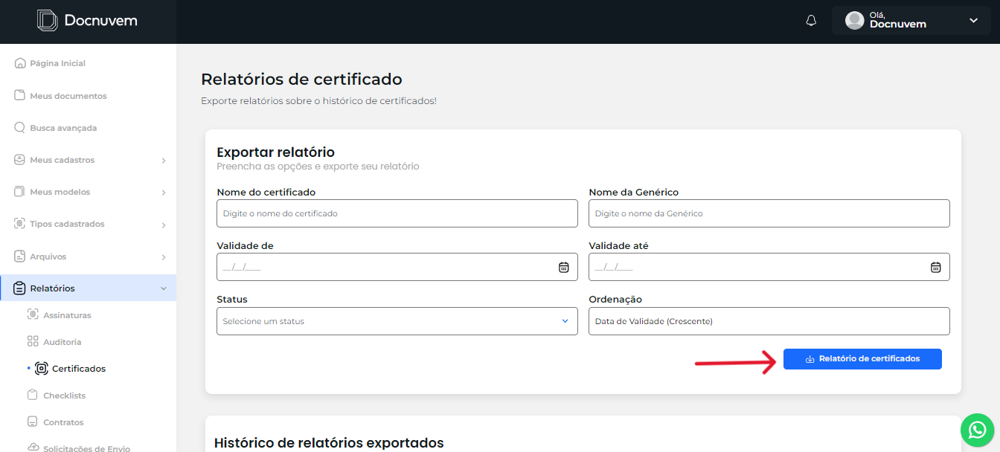

3. Clique no botão para gerar o relatório:
    - **Relatório de certificados:** gera o relatório com os filtros informados.

4. Depois que o relatório é gerado e baixado, ele é adicionado ao **Histórico de relatórios exportados**, na parte de baixo da tela.

<!-- TODO: confirmar com Breno o rótulo do segundo campo de nome no relatório de certificados (no print do manual antigo aparece como "Nome da Genérico", acompanhando o tipo de cadastro da instância) e as opções do campo Status. -->

**Resultado esperado:** o relatório é gerado conforme os filtros informados e fica registrado no histórico de relatórios exportados.

## Relatório de Contratos

O relatório de **Contratos** exporta os dados dos contratos da instância, como as datas de criação e de vencimento.

1. No menu principal, acesse **Relatórios** e clique em **Contratos**.

    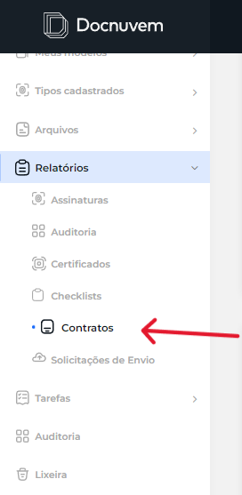

2. Na área **Exportar relatório**, preencha os filtros de busca desejados:
    - **Vencimento de** e **Vencimento até:** período de vencimento dos contratos.
    - **Criação de** e **Criação até:** período em que os contratos foram criados.
    - **Nome:** nome do contrato.
    - **Ordenação:** define a ordem dos resultados. O padrão é **Data de criação (Crescente)**.

    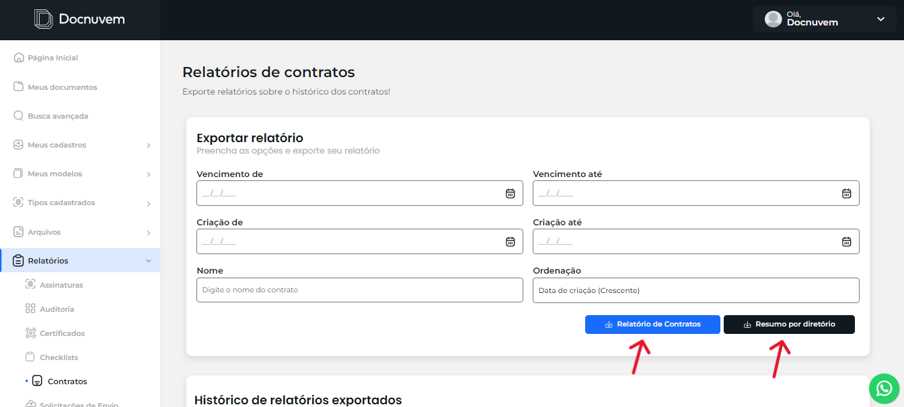

3. Escolha o tipo de relatório que deseja gerar:
    - **Relatório de Contratos:** relatório mais detalhado, com os dados de cada contrato.
    - **Resumo por diretório:** relatório resumido, com a quantidade de contratos por diretório.

4. Depois que o relatório é gerado e baixado, ele é adicionado ao **Histórico de relatórios exportados**, na parte de baixo da tela.

**Resultado esperado:** o relatório é gerado conforme os filtros informados e fica registrado no histórico de relatórios exportados.

## Relatório de Checklists

O relatório de **Checklists** exporta os dados dos checklists vinculados a documentos e diretórios, como o período e o andamento.

1. No menu principal, acesse **Relatórios** e clique em **Checklists**.

    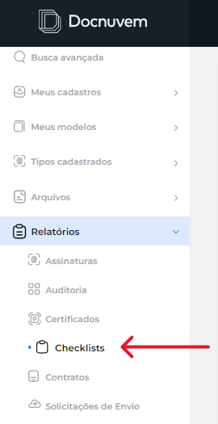

2. Na área **Exportar relatório**, preencha os filtros de busca desejados:
    - **Checklist:** checklist que será considerado no relatório.
    - **Concluído:** filtra por checklists concluídos ou não. O padrão é **Todos**.
    - **Período de** e **Período até:** período considerado no relatório.
    - **Ordenação:** define a ordem dos resultados. O padrão é **Data de vinculação (Crescente)**.
    - **Itens do checklist:** clique em **Adicionar** para filtrar por itens específicos do checklist.

    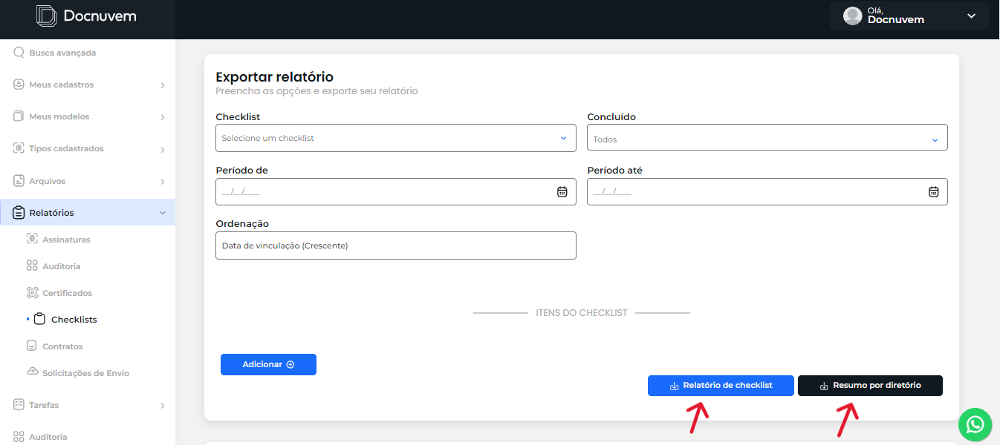

3. Escolha o tipo de relatório que deseja gerar:
    - **Relatório de checklist:** relatório mais detalhado, com os dados de cada checklist.
    - **Resumo por diretório:** relatório resumido, com a quantidade de checklists por diretório.

4. Depois que o relatório é gerado e baixado, ele é adicionado ao **Histórico de relatórios exportados**, na parte de baixo da tela.

**Resultado esperado:** o relatório é gerado conforme os filtros informados e fica registrado no histórico de relatórios exportados.

## Relatório de Solicitações de Envio

O relatório de **Solicitações de Envio** exporta os dados das solicitações de envio de documentos, como a data da solicitação e o status.

1. No menu principal, acesse **Relatórios** e clique em **Solicitações de Envio**.

    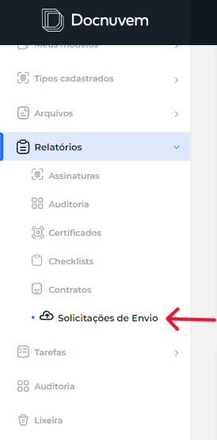

2. Na área **Exportar relatório**, preencha os filtros de busca desejados:
    - **Solicitação de** e **Solicitação até:** período em que a solicitação foi feita.
    - **Validade de** e **Validade até:** período de validade da solicitação.
    - **Modelo de solicitação:** modelo usado na solicitação.
    - **Status:** situação da solicitação.
    - **Ordenação:** define a ordem dos resultados. O padrão é **Data de Solicitação (Crescente)**.

    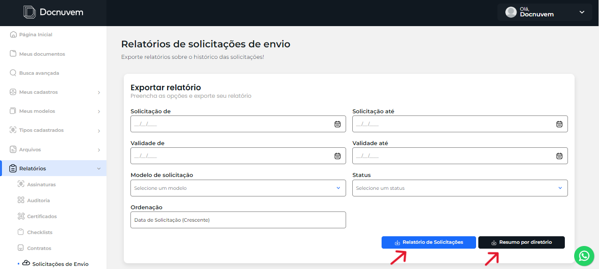

3. Escolha o tipo de relatório que deseja gerar:
    - **Relatório de Solicitações:** relatório mais detalhado, com os dados de cada solicitação.
    - **Resumo por diretório:** relatório resumido, com a quantidade de solicitações de envio por diretório.

4. Depois que o relatório é gerado e baixado, ele é adicionado ao **Histórico de relatórios exportados**, na parte de baixo da tela.

**Resultado esperado:** o relatório é gerado conforme os filtros informados e fica registrado no histórico de relatórios exportados.

## Relatório de Auditoria

O relatório de **Auditoria** exporta o histórico de ações realizadas no Docnuvem, com data e outras informações de cada ação.

1. No menu principal, acesse **Relatórios** e clique em **Auditoria**.

    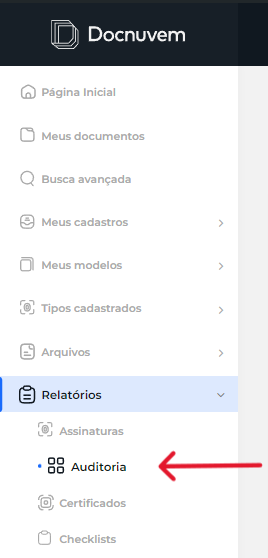

2. Na área **Exportar relatório**, preencha os filtros de busca desejados:
    - **Período de** e **Período até:** período em que as ações foram realizadas.
    - **Usuário:** usuário que realizou a ação.
    - **Ação:** tipo de ação realizada.
    - **Tipo de item** e **Nome do item:** tipo e nome do item em que a ação foi realizada.
    - **Ordenação:** define a ordem dos resultados. O padrão é **Data (Crescente)**.
    - **Observação:** texto a procurar na observação registrada na ação.

    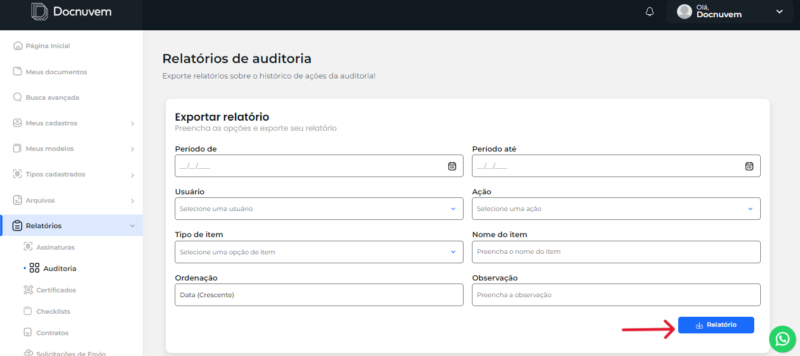

3. Clique no botão para gerar o relatório:
    - **Relatório:** gera o relatório de auditoria com os filtros informados.

4. Depois que o relatório é gerado e baixado, ele é adicionado ao **Histórico de relatórios exportados**, na parte de baixo da tela.

**Resultado esperado:** o relatório é gerado conforme os filtros informados e fica registrado no histórico de relatórios exportados.

## Veja também

- [Dashboard](03-dashboard.md) — indicadores e gráficos com análise detalhada (Drill-Down).
- [Busca Avançada](05-busca-avancada.md) — exportação de relatórios a partir dos resultados de uma busca.
